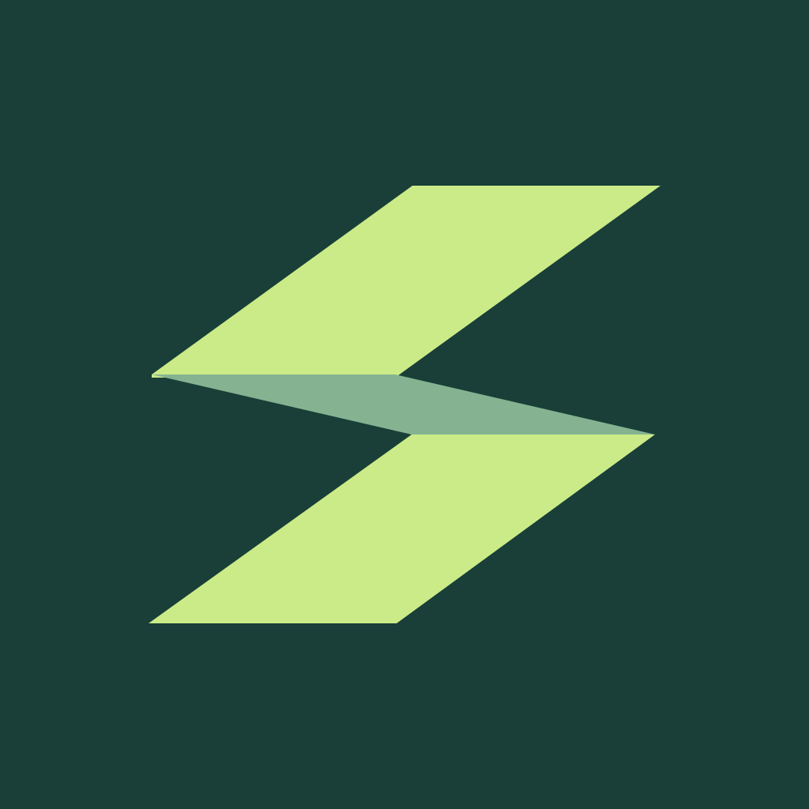
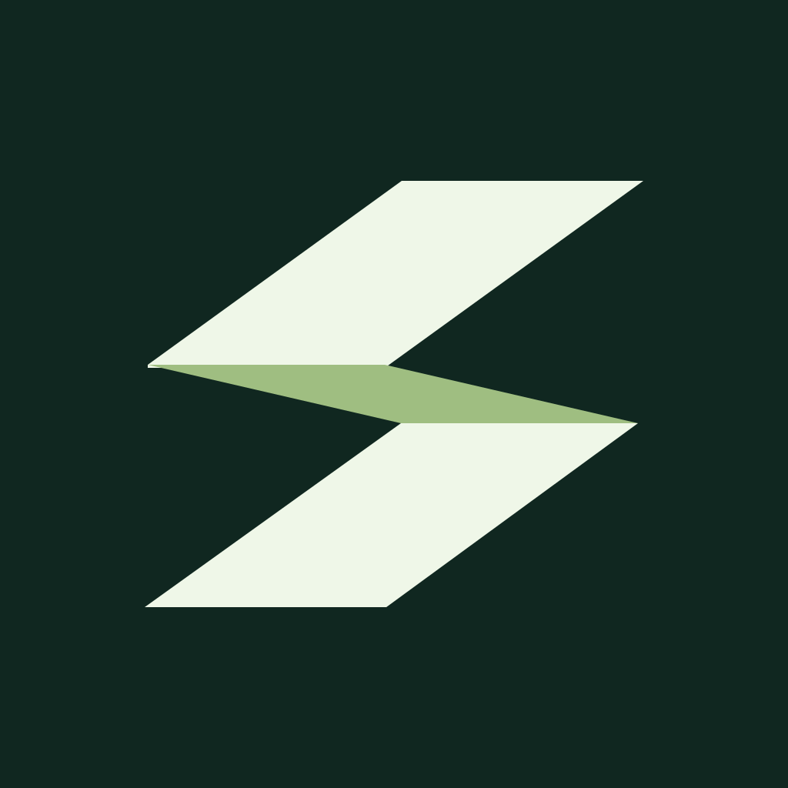
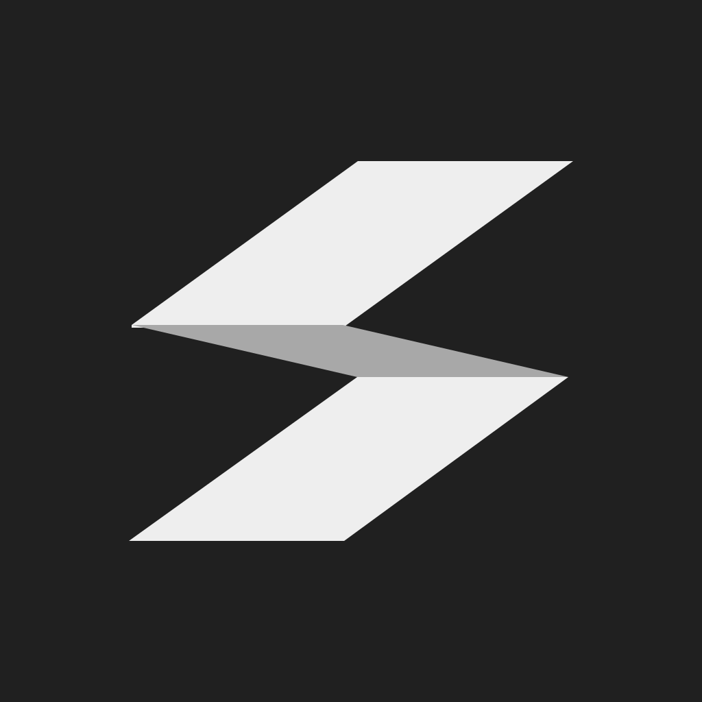
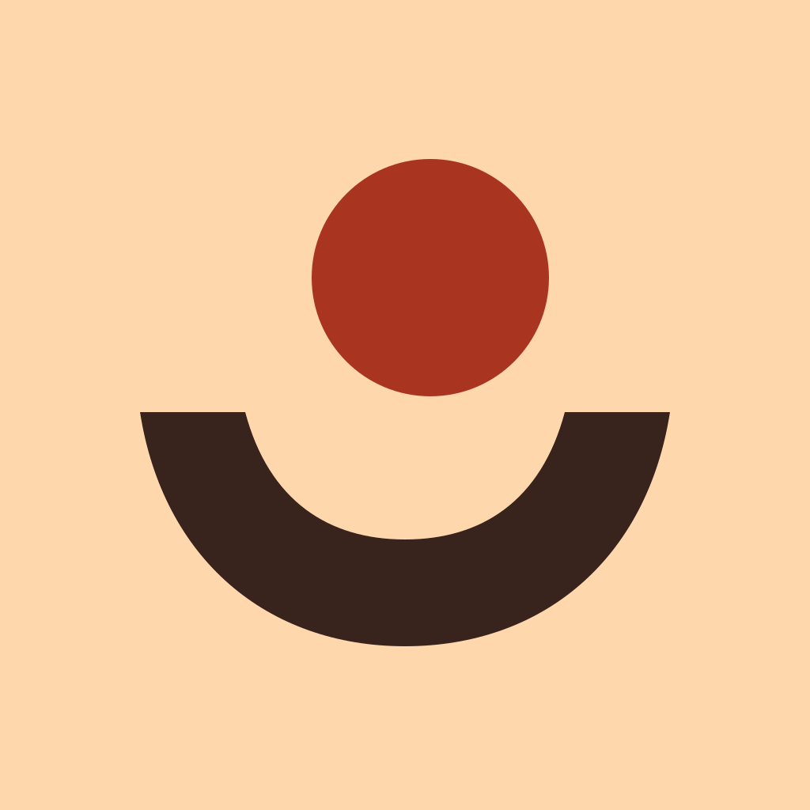
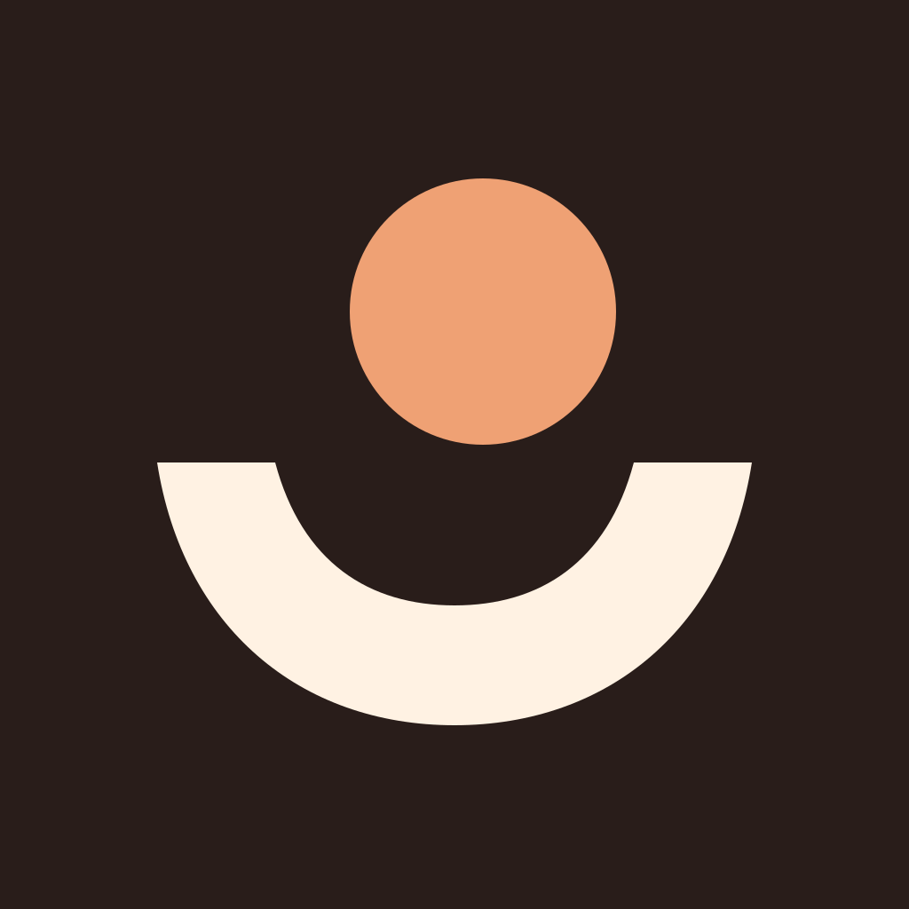
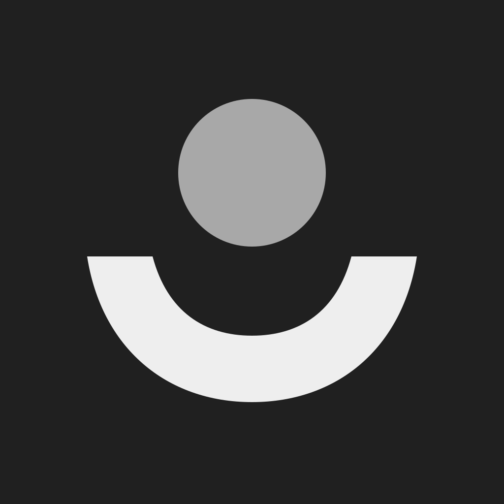
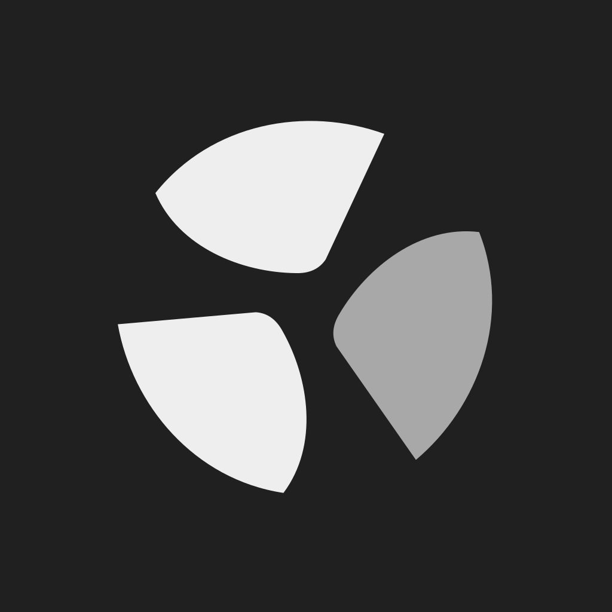

# Enduva brand concepts
Roadmap 0.6 · Owner selection

Open [the standalone specimen](preview.html) locally to compare exact pixel sizes, wordmarks and appearance variants. The three directions use original vector lettering. The suggested open-source typefaces are for product and editorial text.

## A · Switchback

A folded trail links two long traverses with a single turn. The darker return leg gives the mark depth and a direction of travel. Its cut ends carry through to the slanted lettering.

  

Primary **#193F38** · Accent **#CBEB88** · Neutral **#52665D** · Ink **#152B23** · Paper **#FFFFFF**

| Mode | Background | Surface | Text | Text / background | Text / surface |
|---|---|---|---|---:|---:|
| Light | #EFF3EA | #FFFFFF | #152B23 | 13.33:1 | 14.98:1 |
| Dark | #102720 | #223B31 | #EFF7E8 | 14.36:1 | 11.01:1 |

Product typeface: [Barlow (SIL Open Font License)](https://github.com/google/fonts/tree/main/ofl/barlow).

### Export guidance

Set the forest green background in Icon Composer. Keep the three trail paths in one foreground group, with the return leg separately editable. In Dark, use pale traverses and a muted green return leg. In Mono, keep the return leg a middle gray so the fold reads under tint.

## B · Daybreak

A rising disc sits inside an open bowl. The same silhouette can read as a meal, a horizon on an early run, or the pause between training days. A generous gap around the disc keeps both shapes distinct at watch size.

  

Primary **#FFD7AD** · Accent **#A93420** · Neutral **#74594C** · Ink **#38241D** · Paper **#FFFFFF**

| Mode | Background | Surface | Text | Text / background | Text / surface |
|---|---|---|---|---:|---:|
| Light | #FFF6EB | #FFFFFF | #38241D | 13.65:1 | 14.60:1 |
| Dark | #291D1A | #3C2B25 | #FFF2E3 | 14.83:1 | 12.18:1 |

Product typeface: [Manrope (SIL Open Font License)](https://github.com/google/fonts/tree/main/ofl/manrope).

### Export guidance

Set the peach background in Icon Composer. Export the sun and bowl as separate foreground layers on the same canvas to preserve their gap. In Dark, use an apricot sun and a cream bowl on deep brown. In Mono, keep the sun darker than the bowl.

## C · Threefold

Three swept blades share a center, one each for endurance, strength and nutrition. The curved edges give the group a steady rotation, while the small three-sided opening keeps each blade identifiable in one ink.

  

Primary **#30376A** · Accent **#B9D3FF** · Neutral **#62667C** · Ink **#222640** · Paper **#FFFFFF**

| Mode | Background | Surface | Text | Text / background | Text / surface |
|---|---|---|---|---:|---:|
| Light | #F2F3FA | #FFFFFF | #222640 | 13.37:1 | 14.80:1 |
| Dark | #191C32 | #282D49 | #F2F2FF | 15.09:1 | 12.11:1 |

Product typeface: [Space Grotesk (SIL Open Font License)](https://github.com/google/fonts/tree/main/ofl/spacegrotesk).

### Export guidance

Set the indigo background in Icon Composer. Keep the blades in one foreground group with three editable paths sharing the original rotation center. In Dark, use pale outer tones with lavender on the 120° blade. In Mono, give that blade the middle gray and keep the central opening transparent.

## Appearance studies

The opaque square SVGs are comparison studies. Prepare production artwork once the owner selects a concept. The contrast ratios above use WCAG relative luminance for sRGB colors.

- **iOS 27, Icon Composer.** Export aligned foreground SVG layers on a transparent 1024 × 1024 canvas. Set the background fill in Composer and use the studies as color references for Default, Dark and Mono. In Mono, turn on Tinted and try different user tints. [Icon Composer guide](https://developer.apple.com/documentation/xcode/creating-your-app-icon-using-icon-composer)
- **iOS asset catalog.** For a single-size AppIcon set, export the full-color default for Any. Remove the background rectangle from the Dark study before export so the system background shows through. Supply a grayscale image for Tinted. [Asset catalog guide](https://developer.apple.com/documentation/xcode/configuring-your-app-icon)
- **watchOS, Icon Composer.** Center the selected glyph on a 1088 × 1088 canvas and check its edges under the circular system mask. Export unmasked layers. watchOS uses one appearance across light, dark and tinted settings. [Icon Composer guide](https://developer.apple.com/documentation/xcode/creating-your-app-icon-using-icon-composer) · [App icon specifications](https://developer.apple.com/design/human-interface-guidelines/app-icons/#Specifications)
