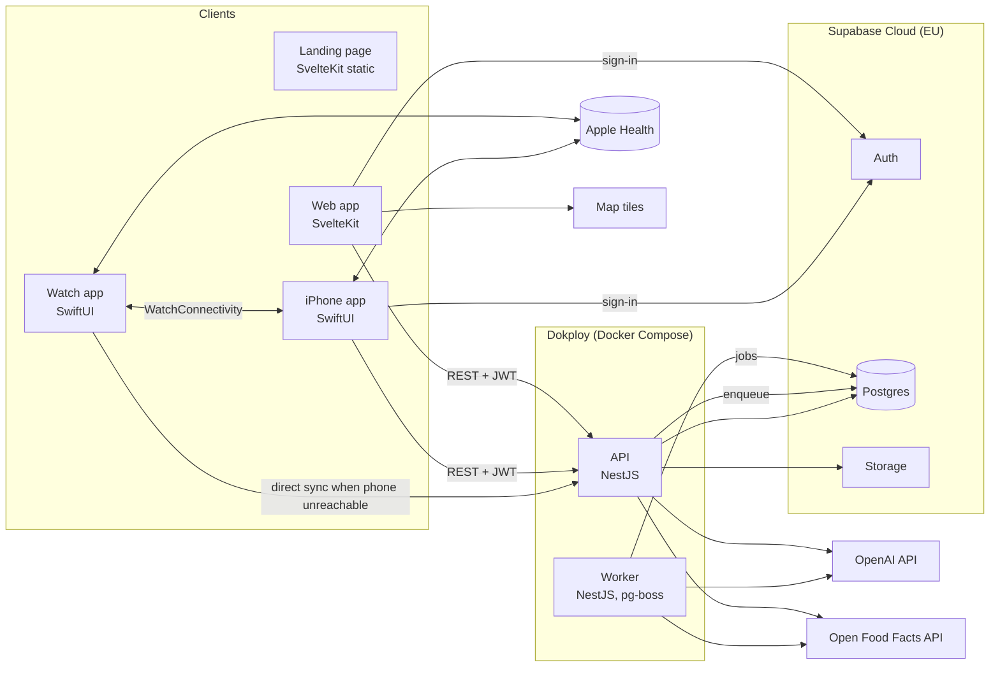

# 02 — Architecture

## System overview



Key points:

- **Clients talk to Supabase only for authentication.** All data access goes through the NestJS API, which owns validation, authorisation and business rules. RLS policies protect against mistakes (defence in depth), and the API connects with a role that respects them where practical.
- **Apple Health is only reachable on Apple devices.** The iPhone (and Watch) app is the bridge: it reads HealthKit data, pushes it to the API and writes Enduva data back to Health.
- **Heavy or slow work runs in the worker**: file parsing, OFF imports, AI analysis, stats recomputation. It uses the same codebase and image as the API with a different entrypoint.

## Tech stack

| Layer | Choice | Notes |
| --- | --- | --- |
| Language (TS) | TypeScript 7 (`tsgo`) | Type checking only. Emit is done by SWC / Vite / esbuild (see below) |
| Package manager / build | pnpm workspaces + Turborepo | Remote caching optional |
| API framework | NestJS 11+ | Built with `@swc/core` (`legacyDecorator`, `decoratorMetadata`). `nest start -b swc` in dev |
| Validation & contracts | Zod 4 schemas in `packages/contracts` | Shared by API + web. OpenAPI generated from them |
| ORM / migrations | Drizzle ORM + drizzle-kit | drizzle-kit generates SQL into `supabase/migrations/`. RLS policies in SQL |
| Jobs | pg-boss | Runs on Supabase Postgres (session pooler / direct connection) |
| AI | Vercel AI SDK (`ai`) with OpenAI provider | Structured output via Zod, tool calling for the coach. Model IDs via env |
| Web | SvelteKit 2, Svelte 5, `adapter-node` | Paraglide JS (i18n), Tailwind CSS 4, MapLibre GL, LayerChart/ECharts |
| Landing | SvelteKit, prerendered | Same design tokens package as the web app |
| Lint / format | oxlint (type-aware via `tsgolint`, which builds on `tsgo`) + Prettier (`prettier-plugin-svelte`) | typescript-eslint relies on the TS JS API that TS 7 lacks |
| Tests (TS) | Vitest (+ `unplugin-swc` for Nest), Playwright E2E, Testcontainers or Supabase local for integration | |
| iOS / watchOS | Swift 6.4, SwiftUI, SwiftData, HealthKit, WorkoutKit, ActivityKit, WidgetKit, VisionKit | Xcode 27, iOS/watchOS 27 deployment target |
| Swift API client | Apple `swift-openapi-generator` from the API's OpenAPI spec | Regenerated in CI. Diff checked |
| Swift auth | `supabase-swift` (Auth only) | |
| Swift lint / format | SwiftLint + `swift-format` | |
| Error tracking | Sentry (or GlitchTip) | SDKs for Node, SvelteKit, Swift |

### TypeScript 7 toolchain (needs validation in spike 0.3)

TS 7 ships the Go-based compiler but **not the full JS compiler API**. That affects any tool that embeds TypeScript:

| Tool | Problem | Plan |
| --- | --- | --- |
| NestJS DI (`emitDecoratorMetadata`) | Needs metadata emit | SWC (`@swc/core` directly or `nest build -b swc` **without** `--type-check`, because Nest's SWC type-check path runs its own TypeScript) emits metadata. `tsgo --noEmit` is the only type checker |
| NestJS Swagger compiler plugin | Runs as a TS compiler plugin, which is unavailable with SWC + TS 7 | **Not used.** OpenAPI is generated from the Zod contracts in `packages/contracts` (e.g. `zod-openapi`), independently of Nest decorators and compiler plugins |
| `svelte-check` | Uses the TS language service via the JS API. The documented `--tsgo` / `--tsgo-experimental-api` modes currently **require TS 6 to be installed next to TS 7** | **Likely blocker for T1. Owner decision needed (O10).** The spike pins a candidate stack, audits which compiler actually runs, and is only "green" if CI fails on deliberately broken `.svelte` props/templates and SvelteKit route types in both `web` and `landing` **without** TS 6 installed |
| typescript-eslint | Uses the JS API | Use oxlint with type-aware rules (`tsgolint`) instead |
| drizzle-kit, vitest | Transpile via esbuild/oxc | Expected to work. Verify |

**Spike 0.3 acceptance (all in CI, no TS 6 in the lockfile):**

1. A representative Nest controller + service + guard with constructor injection boots and passes an e2e test (proves decorator metadata via SWC).
2. `tsgo --noEmit` fails on an intentional type error in `apps/api`, `packages/*` and plain `.ts` files of the SvelteKit apps.
3. A Zod contract → `openapi.json` → `swift-openapi-generator` client compiles for that route, and the web client types are generated from the same spec.
4. `.svelte` type errors and SvelteKit route-type errors fail CI (see the `svelte-check` row).
5. oxlint type-aware rules run on top of `tsgo`.

If any criterion can't be met **without** TS 6, the spike stops, documents the gap in ADR-0001 and the owner decides (T1 says no TS 6). No silent fallback.

## Repository layout

```
enduva/
├─ apps/
│  ├─ api/                 NestJS API + worker entrypoint
│  ├─ web/                 SvelteKit web app (app.enduva…)
│  ├─ landing/             SvelteKit landing page (enduva…)
│  └─ apple/               Xcode project: Enduva (iOS), EnduvaWatch (watchOS), widgets, shared Swift packages
├─ packages/
│  ├─ contracts/           Zod schemas, DTO types, OpenAPI generation
│  ├─ domain/              Pure TS domain logic (calorie goals, 1RM, splits, units) — no I/O
│  ├─ db/                  Drizzle schema, queries, seed scripts
│  ├─ i18n/                Shared message catalogs (de, en) for web + landing
│  ├─ ui/                  Shared Svelte components + design tokens
│  └─ config/              Shared tsconfig, oxlint, prettier, vitest presets
├─ supabase/               Supabase CLI config, migrations, seed.sql
├─ deploy/                 compose.yaml, Dockerfiles, Dokploy scripts
├─ docs/
│  ├─ plan/                This plan
│  └─ adr/                 Architecture Decision Records
├─ .github/                Workflows, PR template, CODEOWNERS
├─ AGENTS.md               Rules for coding agents (also read by Claude via CLAUDE.md)
└─ CLAUDE.md               → points to AGENTS.md
```

Swift code that runs on both iPhone and Watch (models, sync engine, HealthKit mapping, API client) lives in a **local Swift package** inside `apps/apple/` (`EnduvaKit`). That keeps targets small and testable.

## API design

- REST under `/v1`. Resources: `/me`, `/activities`, `/exercises`, `/routines`, `/workouts`, `/foods`, `/diary`, `/goals`, `/body`, `/plans`, `/ai/*`, `/sync`, `/exports`.
- **OpenAPI 3.1** generated at build time and committed (`apps/api/openapi.json`). CI fails if it is out of date. Web and Swift clients are generated from it.
- Errors follow RFC 9457 (problem+json). Every error has a stable `code` that the clients translate.
- Cursor pagination, `ETag`s on detail resources, `Idempotency-Key` header on all POSTs from mobile.
- Timestamps in UTC (ISO 8601). Users have an IANA time zone. Diary days are computed in the user's zone.

## Authentication & authorisation

1. Clients sign in with Supabase Auth (email + password, magic link, Google OAuth. Apple if O2 is accepted).
2. Clients send the Supabase access token as `Authorization: Bearer` to the API.
3. **Token verification:** the API verifies the JWT against Supabase's **JWKS** (asymmetric signing keys, cached with rotation support). It accepts only the asymmetric algorithm configured for the project (e.g. `ES256`) and never `HS256`/`none`. It requires the exact per-environment `iss` (`https://<project>.supabase.co/auth/v1`, local URL in dev), `aud = authenticated`, `role = authenticated`, and a valid `exp`/`iat` with small clock-skew tolerance. Only then is `sub` trusted as the user ID. Asymmetric signing keys are enabled in **local and hosted** environments, so the JWKS path is tested everywhere.
4. **Account/session status:** a verified token can outlive logout or account deletion (until `exp`). For every **write** and before each **queued job** runs, the API checks that the profile is active (not deleted or locked) and that the token's `session_id` still exists (cached for a few seconds). Reads check profile status. Test: delete an account, then reuse its unexpired token → 401 for writes and jobs.
5. On the user's first request, the API creates their `profiles` row (or a DB trigger on `auth.users` does it).
6. **Authorisation:** resource ownership checks in services. `role` (user/admin) and **entitlements** live in our DB, not in the JWT, so they can change without re-login.

### Tenant isolation (ADR-0002, task 0.7)

RLS is only a safety net if the API actually runs **under** it, so:

- **Least-privilege roles:** `enduva_api` (request path) and `enduva_worker` (jobs) are custom roles **without** `BYPASSRLS` and not table owners. Migrations run as a separate owner role. `service_role` is never used by the running API.
- **Transaction-local identity:** every request runs its queries in one transaction that first executes `set_config('request.jwt.claims', <verified claims>, true)` / `set local role`. Nothing is session-scoped, so this works with Supabase's **transaction pooler**. If the driver uses named prepared statements, they are disabled for the pooler.
- **No Data API exposure:** API-only tables are not granted to `anon`/`authenticated`, and the API schema isn't exposed through PostgREST, because clients never query Supabase directly.
- **Worker jobs** carry a `user_id`, and the worker sets the same transaction-local identity per job. Cross-user jobs (imports of global catalogs) use a dedicated catalog-writer role limited to catalog tables.
- **Tests:** an integration suite runs as user A against user B's data (parent and child tables, private custom foods/exercises, storage paths) **through the real pooler connection string**, and every query must return nothing or 404.

## Apple Health & sync

### HealthKit (iPhone)

- **Read:** `HKWorkout` (running, cycling, hiking, walking→hiking mapping optional, swimming), `HKWorkoutRoute`, heart rate, active energy, distance, cadence/power where present, swimming strokes/laps, body mass.
- **Write:** dietary energy + macros + water (per diary entry, with HK metadata linking back to Enduva IDs), body mass, Enduva strength workouts (from Watch/iPhone).
- **Change tracking:** `HKAnchoredObjectQuery` with persisted anchors, plus `HKObserverQuery` + background delivery, so new workouts sync without opening the app.
- **Dedupe:** each imported record stores `source = healthkit` + `external_id = HK UUID`. Workouts that Enduva wrote itself carry an Enduva ID in metadata and are skipped on import.
- **Streams:** samples are resampled to 1 Hz (or per-sample for low-frequency data) and uploaded compressed. The server keeps the full stream plus a downsampled version for charts.

### Offline-first sync (iPhone + Watch ↔ API)

- Local store: **SwiftData** with client-generated UUIDv7 IDs.
- Outbox pattern: every local mutation writes an outbox entry. The sync engine pushes batches to `POST /v1/sync/push` (idempotent per mutation ID).
- Pull: `GET /v1/sync/pull?cursor=…` returns changes since a server cursor (monotonic `change_seq` per user), including tombstones for deletions.
- Conflicts: last-writer-wins per record using a server-assigned version. Workout sets are append-mostly, which keeps conflicts rare. Diary entries are LWW.
- **Watch:** syncs with the iPhone over WatchConnectivity when reachable, and otherwise directly with the API over Wi-Fi/LTE (same sync protocol, own auth token shared via Keychain access group).

### Watch strength session

- `HKWorkoutSession` + `HKLiveWorkoutBuilder` (activity type `traditionalStrengthTraining` / `functionalStrengthTraining` / `highIntensityIntervalTraining`) for HR and energy.
- The session can be started on either device. With iOS/watchOS mirrored workout sessions, the iPhone shows the same session and a Live Activity.
- When finished: the HKWorkout is saved to Health (tagged with the Enduva ID), and the workout with all sets is synced to the API.

## AI architecture

```
apps/api/src/ai/
  ai.module.ts          provider setup (AI SDK), model registry from env
  usage/                token + cost accounting, per-user quotas, entitlements check
  consent/              guard: refuses AI calls without consent
  nutrition/            photo + text → items, grams, clarifying questions
  training/             activity analysis, plan generation, plan adaptation
  coach/                chat with tool calling (read-only tools over user data)
  prompts/              versioned prompt templates (de/en), tested with fixtures
```

- **Provider abstraction:** AI SDK `LanguageModel` instances are resolved from a model registry (`AI_MODEL_FAST`, `AI_MODEL_SMART`, `AI_MODEL_VISION`). OpenAI is the default provider. Others are a config change away.
- **Structured outputs everywhere.** Every response is validated with Zod. Invalid output → one retry → user-facing error.
- **Nutrition recognition flow:**
  1. Client uploads a photo (to Supabase Storage via a signed URL) and/or text.
  2. `POST /v1/ai/nutrition/recognitions` → the model returns candidate items with estimated grams, confidence and **clarifying questions** (each with suggested answers).
  3. Client shows the questions. The user answers → `POST …/recognitions/:id/answers` → refined items.
  4. Each item is **matched to the food DB** (Postgres full-text + trigram search on BLS/OFF/custom foods, with the AI producing a normalised search term). If nothing matches well, a nutrition estimate is used and flagged as "AI estimate".
  5. The user confirms or edits, and the entries go into the diary. Nothing is logged without confirmation.
- **Training:** plan generation produces a typed plan (weeks → sessions with structured intervals or strength prescriptions). The server validates it (volume sanity limits, rest days) before saving.
- **Coach:** the chat model gets read-only tools (`getActivities`, `getWorkouts`, `getDiarySummary`, `getBodyTrend`, `getCurrentPlan`) scoped to the current user. Conversations are stored and can be deleted.
- **Cost control:** every call is logged in `ai_usage` (tokens, model, feature, cost estimate). Quotas per entitlement tier and day/month. Long-running calls run in the worker and are streamed or polled.
- **Privacy & data processing:**
  - Only feature-relevant data is sent (data-minimised payloads per feature, documented in `docs/privacy/ai-data-flows.md`: which endpoint receives which fields).
  - Consent is purpose-specific (AI nutrition, AI training/coach), stored with timestamp and version, and revocable.
  - The **worker re-checks consent and account status immediately before calling the provider.** Queued jobs of a revoked or deleted user are dropped, not sent.
  - **Before the beta gate (see roadmap)**: document the provider terms (OpenAI DPA, no training on API data, retention: default abuse-monitoring retention vs. Zero Data Retention / EU data residency eligibility), the regional processing, and the transfer basis (EU–US Data Privacy Framework / SCCs). Pick the strictest retention setting available to the account.
  - **HealthKit data** is only sent to the AI provider with the user's explicit permission for that purpose, in line with App Review Guideline 5.1.3 (no use for advertising, no sharing beyond the stated purpose). The App Store privacy label lists the AI provider as a processor.

## Food data pipeline

| Source | Import | Notes |
| --- | --- | --- |
| **BLS 4.0** | One-time import + update script (`packages/db/seed/bls`) | ~7,000 generic foods, up to 138 nutrients. German names, English names where provided. Keep source IDs |
| **Open Food Facts** | (a) On-demand barcode lookup via OFF API → cached in `foods`. (b) Optional import of a **DACH subset** (products sold in DE/AT/CH with complete nutrition) from the OFF dump, refreshed weekly by a worker job | ODbL: attribution required, and the derived DB remains ODbL. Respect the OFF API rate limits and set a proper User-Agent |
| **Custom foods** | User-created, private | Also produced by "save AI estimate as food" |

Search: Postgres `tsvector` (German + English configs) + `pg_trgm`, ranked by source quality, popularity per user (recents/favourites) and completeness. `pgvector` embeddings can be added later if needed.

## Internationalisation

- Web + landing: Paraglide JS with message files in `packages/i18n/messages/{de,en}.json`. Locale from user setting → `Accept-Language` → `en`.
- Apple: String Catalogs (`Localizable.xcstrings`), and the same keys where it makes sense.
- API: returns error **codes**, not prose. AI prompts carry the user's locale so model output is in the right language.
- Data: `exercise_translations`, `food_translations` (locale, name, aliases).
- Formatting: always metric. Locale-aware number/date formatting (`de-DE` uses decimal commas).

## Security baseline

- HTTPS everywhere (Traefik via Dokploy, Let's Encrypt).
- CORS: only the app and landing origins. Mobile apps aren't subject to CORS.
- Rate limiting per IP + per user (`@nestjs/throttler`, stricter for auth-adjacent and AI routes).
- Upload validation (size, MIME, image re-encoding), signed upload URLs with a short TTL.
- Dependency updates via Renovate. `pnpm audit` + CodeQL in CI.
- Secrets never in the repo (the repo is public). Gitleaks runs in CI.
