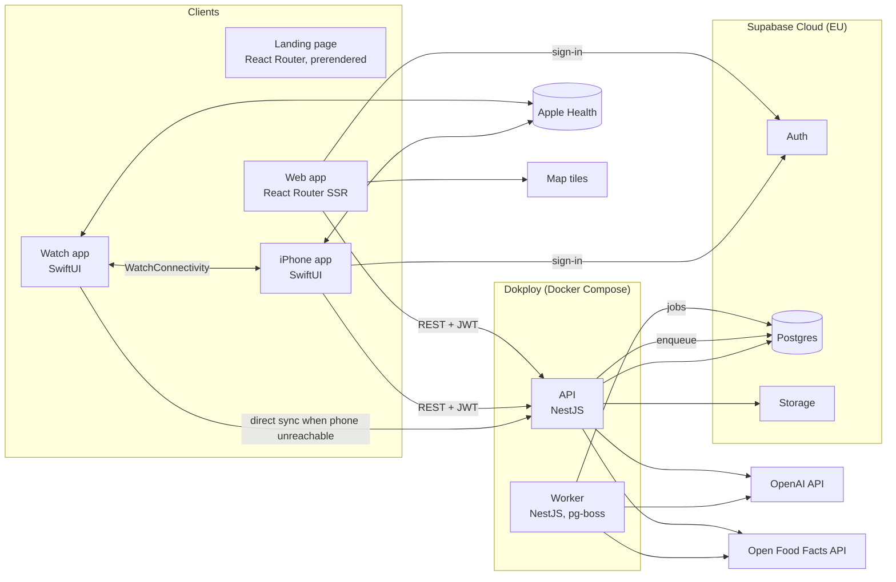

# 02 — Architecture

## System overview



Key points:

- **Clients talk to Supabase only for authentication.** All data access goes through the NestJS API, which owns validation, authorisation and business rules. RLS policies protect against mistakes (defence in depth), and the API connects with a role that respects them where practical.
- **Apple Health is only reachable on Apple devices.** The iPhone (and Watch) app is the bridge: it reads HealthKit data, pushes it to the API and writes Enduva data back to Health.
- **Heavy or slow work runs in the worker**: file parsing, OFF imports, AI analysis, stats recomputation. It uses the same codebase and image as the API with a different entrypoint.

## Tech stack

| Layer | Choice | Notes |
| --- | --- | --- |
| Language (TS) | TypeScript 7 (`typescript@7`, native CLI `tsc`) | Type checking only. Emit is done by SWC / Vite / esbuild (see below) |
| Package manager / build | pnpm workspaces + Turborepo | Remote caching optional |
| API framework | NestJS 11+ (runtime packages only, no Nest CLI) | Built with `@swc/cli` + `@swc/core` directly (`legacyDecorator`, `decoratorMetadata`). Dev: `swc --watch` + `node --watch` |
| Validation & contracts | Zod 4 schemas in `packages/contracts` | Shared by API + web. OpenAPI generated from them |
| ORM / migrations | Drizzle ORM + drizzle-kit | drizzle-kit generates SQL into `supabase/migrations/`. RLS policies in SQL |
| Jobs | pg-boss | Runs on Supabase Postgres (session pooler / direct connection) |
| AI | Vercel AI SDK (`ai`) with OpenAI provider | Structured output via Zod, tool calling for the coach. Model IDs via env |
| Web | React 19 + React Router 7 (framework mode, Vite, SSR via `@react-router/node`) | Paraglide JS (i18n), Tailwind CSS 4, Radix-based components (shadcn/ui pattern), MapLibre GL (`react-map-gl`), Recharts/ECharts, TanStack Query for the generated API client |
| Landing | React Router 7 with full prerendering (static files) | Same design tokens and UI package as the web app |
| Lint / format | oxlint (type-aware via `tsgolint`, which builds on the TS 7 native compiler) + Prettier | typescript-eslint relies on the TS JS API that TS 7 lacks |
| Tests (TS) | Vitest (+ `unplugin-swc` for Nest), Playwright E2E, Testcontainers or Supabase local for integration | |
| iOS / watchOS | Swift 6.4, SwiftUI, SwiftData, HealthKit, WorkoutKit, ActivityKit, WidgetKit, VisionKit | Xcode 27, iOS/watchOS 27 deployment target |
| Swift API client | Apple `swift-openapi-generator` from the API's OpenAPI spec | Regenerated in CI. Diff checked |
| Swift auth | `supabase-swift` (Auth only) | |
| Swift lint / format | SwiftLint + `swift-format` | |
| Error tracking | Self-hosted GlitchTip (Sentry protocol) | Sentry SDKs for Node, React, Swift |

### TypeScript 7 toolchain (needs validation in spike 0.3)

TS 7 ships the Go-based compiler but **not the full JS compiler API**. That affects any tool that embeds TypeScript:

| Tool | Problem | Plan |
| --- | --- | --- |
| NestJS DI (`emitDecoratorMetadata`) | Needs metadata emit | **SWC directly** (`@swc/cli` + `@swc/core` with `legacyDecorator` and `decoratorMetadata`) emits metadata. **Not** via the Nest CLI (`nest build`/`nest start`), because the Nest CLI has a direct dependency on an older `typescript` package. Dev mode uses `swc --watch` + `node --watch`. TS 7 `tsc --noEmit` is the only type checker |
| NestJS Swagger compiler plugin | Runs as a TS compiler plugin, which is unavailable with SWC + TS 7 | **Not used.** OpenAPI is generated from the Zod contracts in `packages/contracts` (e.g. `zod-openapi`), independently of Nest decorators and compiler plugins |
| React / React Router | `.tsx` is plain TypeScript. React Router generates route types (`react-router typegen`) as `.ts` files. `@react-router/dev` declares TypeScript 5/6 only as an **optional** peer dependency | **No special checker needed:** TS 7 `tsc` type-checks components and the generated route types directly. Typegen runs before `tsc` in CI. The optional TS 5/6 peer must stay uninstalled (lockfile audit). (SvelteKit was dropped because `svelte-check` needs TS 6 next to TS 7; former O10) |
| typescript-eslint | Uses the JS API | Use oxlint with type-aware rules (`tsgolint`) instead |
| drizzle-kit, vitest | Transpile via esbuild/oxc | Expected to work. Verify |

**Spike 0.3 acceptance (all in CI, no TS 6 in the lockfile):**

1. A representative Nest controller + service + guard with constructor injection boots and passes an e2e test (proves decorator metadata via SWC).
2. TS 7 `tsc --noEmit` fails on an intentional type error in `apps/api`, `packages/*`, `apps/web` and `apps/landing`.
3. A Zod contract → `openapi.json` → `swift-openapi-generator` client compiles for that route, and the web client types are generated from the same spec.
4. In both React apps, a broken component prop and a broken route param/loader type (from `react-router typegen`) fail CI. Nothing in the toolchain pulls in TypeScript 6 (checked with `pnpm why typescript`).
5. oxlint type-aware rules run on top of the TS 7 compiler.
6. **Pinned candidate stack** (exact versions in ADR-0001). `pnpm install --frozen-lockfile`, typegen, type-check and **production builds** of `api`, `web` and `landing` all pass, and a CI **lockfile audit** fails if the resolved lockfile contains any `typescript` below 7, any alias of it (`npm:typescript@…`), or any other pre-7 compiler package.

If any criterion can't be met **without** TS 6, the spike stops, documents the gap in ADR-0001 and the owner decides (T1 says no TS 6). No silent fallback.

## Repository layout

```
enduva/
├─ apps/
│  ├─ api/                 NestJS API + worker entrypoint
│  ├─ web/                 React Router web app (app.enduva…)
│  ├─ landing/             React Router landing page, prerendered (enduva…)
│  └─ apple/               Xcode project: Enduva (iOS), EnduvaWatch (watchOS), widgets, shared Swift packages
├─ packages/
│  ├─ contracts/           Zod schemas, DTO types, OpenAPI generation
│  ├─ domain/              Pure TS domain logic (calorie goals, 1RM, splits, units) — no I/O
│  ├─ db/                  Drizzle schema, queries, seed scripts
│  ├─ i18n/                Shared message catalogs (de, en) for web + landing
│  ├─ ui/                  Shared React components + design tokens
│  └─ config/              Shared tsconfig, oxlint, prettier, vitest presets
├─ supabase/               Supabase CLI config, migrations, seed.sql
├─ deploy/                 compose.yaml, Dockerfiles, Dokploy scripts
├─ docs/
│  ├─ plan/                This plan
│  └─ adr/                 Architecture Decision Records
├─ .github/                Workflows, PR template, CODEOWNERS
├─ AGENTS.md               Rules for coding agents (also read by Claude via CLAUDE.md)
└─ CLAUDE.md               → points to AGENTS.md
```

Swift code that runs on both iPhone and Watch (models, sync engine, HealthKit mapping, API client) lives in a **local Swift package** inside `apps/apple/` (`EnduvaKit`). That keeps targets small and testable.

## API design

- REST under `/v1`. Resources: `/me`, `/activities`, `/exercises`, `/routines`, `/workouts`, `/foods`, `/diary`, `/goals`, `/body`, `/plans`, `/ai/*`, `/sync`, `/exports`.
- **OpenAPI 3.1** generated at build time and committed (`apps/api/openapi.json`). CI fails if it is out of date. Web and Swift clients are generated from it.
- Errors follow RFC 9457 (problem+json). Every error has a stable `code` that the clients translate.
- Cursor pagination, `ETag`s on detail resources, `Idempotency-Key` header on all POSTs from mobile.
- Timestamps in UTC (ISO 8601). Users have an IANA time zone. Diary days are computed in the user's zone.

## Authentication & authorisation

1. Clients sign in with Supabase Auth (email + password, magic link, Google OAuth, Sign in with Apple).
2. Clients send the Supabase access token as `Authorization: Bearer` to the API.
3. **Token verification:** the API verifies the JWT against Supabase's **JWKS** (asymmetric signing keys, cached with rotation support). It accepts only the asymmetric algorithm configured for the project (e.g. `ES256`) and never `HS256`/`none`. It requires the exact per-environment `iss` (`https://<project>.supabase.co/auth/v1`, local URL in dev), `aud = authenticated`, `role = authenticated`, and a valid `exp`/`iat` with small clock-skew tolerance. Only then is `sub` trusted as the user ID. Asymmetric signing keys are enabled in **local and hosted** environments, so the JWKS path is tested everywhere.
4. **Account/session status:** a verified token can outlive logout, device revocation or account deletion (until `exp`). On **every** request (reads, writes, sync pulls, file downloads, upload-URL creation) and before each **queued job** runs, the API checks that the profile is active (not deleted or locked) and that the token's `session_id` still exists and its device isn't revoked. This check is **synchronous and uncached**: an indexed lookup of profile, session and device status inside the request's own transaction, so once a revocation has committed, no later request is authorised. Only the JWKS keys are cached. Tests: reusing a deleted account's unexpired token → 401 everywhere. A revoked device's unexpired token → `401 device_revoked`, **also with a warmed authorization cache** (revoke right after a successful request).
5. On the user's first request, the API creates their `profiles` row (or a DB trigger on `auth.users` does it).
6. **Authorisation:** resource ownership checks in services. `role` (user/admin) and **entitlements** live in our DB, not in the JWT, so they can change without re-login.

### Tenant isolation (ADR-0002, task 0.7)

RLS is only a safety net if the API actually runs **under** it, so:

- **Least-privilege roles:** `enduva_api` (request path) and `enduva_worker` (jobs) are custom roles **without** `BYPASSRLS` and not table owners. Migrations run as a separate owner role. `service_role` is never used by the running API.
- **Transaction-local identity:** every request runs its queries in one transaction that first executes `set_config('request.jwt.claims', <verified claims>, true)` / `set local role`. Nothing is session-scoped, so this works with Supabase's **transaction pooler**. If the driver uses named prepared statements, they are disabled for the pooler.
- **No Data API exposure:** API-only tables are not granted to `anon`/`authenticated`, and the API schema isn't exposed through PostgREST, because clients never query Supabase directly.
- **Worker jobs** carry a `user_id`, and the worker sets the same transaction-local identity per job. Cross-user jobs (imports of global catalogs) use a dedicated catalog-writer role limited to catalog tables.
- **Private file downloads** (exports, original activity files, meal photos, avatars, share-link media) are **never handed out as Supabase signed URLs**. Clients fetch them through API endpoints (`/v1/files/:id`, share endpoints) that run the full authorisation check on **each** request and stream the object from Storage server-side with `Cache-Control: no-store`. **All buckets are private**, with no Storage policies for `anon`/`authenticated`, so clients can't read objects directly. Only the API's server role can. A revoked device or a revoked share link is therefore blocked for **every request started after the revocation**. Streams already in flight at that moment are not cut off. They are short (bounded file sizes, no resumable downloads), which is accepted. Tests: direct Storage reads with a user JWT are denied for every bucket. Uploads still use short-lived signed **upload** URLs, and the processing job re-checks authorisation and consent before using the file. Test: a download link obtained before revocation returns 401/404 afterwards.
- **Tests:** an integration suite runs as user A against user B's data (parent and child tables, private custom foods/exercises, storage paths) **through the real pooler connection string**, and every query must return nothing or 404.

## Apple Health & sync

### HealthKit (iPhone)

- **Read:** `HKWorkout` (running, cycling, hiking, walking→hiking mapping optional, swimming), `HKWorkoutRoute`, heart rate, active energy, distance, cadence/power where present, swimming strokes/laps, body mass, **VO2max** (`vo2Max`) and **resting heart rate** (for training load and thresholds).
- **Write:** dietary energy + macros + water (per diary entry, with HK metadata linking back to Enduva IDs), body mass, Enduva strength workouts (from Watch/iPhone).
- **Change tracking:** `HKAnchoredObjectQuery` with persisted anchors, plus `HKObserverQuery` + background delivery, so new workouts sync without opening the app.
- **Dedupe:** each imported record stores `source = healthkit` + `external_id = HK UUID`. Workouts that Enduva wrote itself carry an Enduva ID in metadata and are skipped on import.
- **Streams:** samples are resampled to 1 Hz (or per-sample for low-frequency data) and uploaded compressed. The server keeps the full stream plus a downsampled version for charts.

### Offline-first sync (iPhone + Watch ↔ API)

The sync contract is specified in ADR-0004 and covered by a dedicated test suite before any feature relies on it.

- **Local store:** SwiftData with client-generated UUIDv7 IDs. Every local change writes an **outbox mutation** `{mutation_id, entity, entity_id, op (upsert/delete), base_version, payload, client_time}`.
- **Push:** `POST /v1/sync/push` takes batches. `mutation_id` is unique per user, so a duplicate delivery (Watch → iPhone relay **and** Watch → API directly, retries after timeouts) returns the stored result instead of applying twice.
- **Commit-ordered change feed:** each user has a `sync_state(user_id, last_seq)` row. Every write transaction increments it with `UPDATE … RETURNING` and stamps the changed rows with that `change_seq`. The row lock is held until commit, so a user's changes **become visible in sequence order** and a pull can never skip a lower sequence that commits later. Tested with parallel write transactions and interleaved pulls against real Postgres.
- **Pull:** `GET /v1/sync/pull?cursor=…` returns all rows and tombstones after the cursor, paginated, plus the new cursor. The cursor is a **composite, unique position** `(change_seq, entity, id)` with a stable sort order, so a transaction that stamped more rows than fit on one page continues exactly where the previous page ended.
- **Stale writes (optimistic concurrency):** a mutation carries the `base_version` it was made against.
  - `base_version` = current version → applied, version + 1.
  - Stale `base_version` → **rejected with a conflict result** containing the current server record. The client then applies a per-entity policy. For workout sets and diary entries, the server state is kept and the local change is shown as a "changed on another device" notice the user can re-apply. No silent overwrite.
  - Creates (no `base_version`) never conflict, because IDs are client-generated UUIDs.
  - **Update or delete of an absent row** (never existed, or purged after tombstone retention) → conflict `gone`. The client drops the change and shows a notice. An update carrying a base version is **never** treated as an upsert/create.
- **Deletes:** soft deletes produce tombstones. A delete **wins** against any update with an older `base_version`, so a delayed Watch edit can't resurrect a deleted set. Restoring is an explicit user action that creates a new version.
- **Tombstone retention:** 90 days. A cursor older than the retention window gets `410 Gone`. The client then performs a **full resync**: the server builds the snapshot in one `REPEATABLE READ` transaction and returns it with a **watermark** (the `sync_state.last_seq` read in that same snapshot, so it matches exactly the data included). The client replaces its store, continues pulling from the watermark, and rebases its still-unsent outbox on top. Rebase **preserves each mutation's op and base version**: an update stays an update and is never turned into a create.
- **Required tests:** duplicate delivery via two paths, stale update after delete, **offline edit reconnecting after the target was deleted and purged**, concurrent edits from Watch and iPhone, a multi-row transaction straddling a page boundary, a concurrent write during snapshot creation, cursor expiry + full resync with a pending outbox, and offline create → edit → delete before the first sync.

### Watch credentials

The Watch has its own keychain, so keychain access groups **can't** share the iPhone's session with it. The Watch therefore gets its own **device-specific session**:

1. On the iPhone, the signed-in app requests a short-lived, single-use **device link code** (`POST /v1/devices/link`) and sends it to the Watch via WatchConnectivity.
2. The Watch exchanges the code (`POST /v1/devices/exchange`) for its **own Supabase session**, e.g. via a server-generated one-time token verified by the Watch. The exact mechanism is decided in ADR-0005. The result is a separate session ID and refresh token, registered in `devices`.
3. The Watch stores the session in **its own keychain** and refreshes it independently, so it works with the phone offline (Wi-Fi/LTE).
4. **Revocation:** sign-out or account switch on the iPhone revokes all device sessions server-side and tells the Watch (WatchConnectivity) to wipe its keychain and local store. A "Devices" list in settings revokes single devices. Revoked sessions fail the session check, which runs on **every** request including reads, sync pulls and signed-URL creation (see Authentication). A removed Watch may never receive the wipe message, so it also **wipes its local account data** as soon as any API call returns `401 device_revoked`, **or on terminal session loss** (refresh token rejected, e.g. after it reconnects with an expired access token). Unsynced local changes are lost in that case, which is acceptable for a revoked device. It never serves cached data from a revoked account. Tests cover reconnect after JWT expiry.
5. Validated on a real paired device: setup, token expiry with the phone switched off, recovery after revocation, and a **revoked, disconnected Watch with an unexpired token** (must get no private data on any endpoint).

### Strength session recording (Watch ↔ iPhone)

Apple's mirroring model: the **Watch owns the primary `HKWorkoutSession`**, and the iPhone gets a mirrored session.

| Mode | Started on | Recorder (primary session) | HealthKit save authority | HR |
| --- | --- | --- | --- | --- |
| Watch-only | Watch | Watch | Watch | yes |
| Mirrored | Watch, or iPhone with a reachable paired Watch (`startWatchApp(toHandle:)` wakes the Watch, which creates the primary session) | Watch | **Watch only** | yes |
| Phone-only | iPhone, no Watch available or user chooses "without Watch" | iPhone (own workout session) | iPhone | from other sources only |

- Activity types: `traditionalStrengthTraining`, `functionalStrengthTraining`, `highIntensityIntervalTraining`.
- **Set logging is Enduva data, not HealthKit data.** Set edits on either device become outbox mutations (same IDs and semantics as the sync protocol). During a mirrored session they are exchanged live over the session's data channel (`sendToRemoteWorkoutSession`), and both devices also push them to the API. Duplicates are removed by `mutation_id`.
- **Disconnect:** both devices keep logging locally. On reconnect, mutations are exchanged, and either way the API converges them. Only the primary device ends and saves the `HKWorkout` (tagged with the Enduva workout ID). The other device never saves a second one.
- **Watch becomes unavailable mid-session** (battery, out of range): the iPhone continues logging sets. The Enduva workout is sync data and stays intact regardless of what happens to the HealthKit session.
- **Finishing while the Watch is unreachable:** the iPhone records a durable `finish` mutation with the authoritative end time (synced to the API) **and** queues it with `transferUserInfo` (guaranteed, queued delivery). The Watch applies it from whichever channel arrives first (WatchConnectivity or its next sync pull), ends the session with that end date and saves.
- **Unrecoverable HealthKit session** (`recoverActiveWorkoutSession` is crash recovery and can fail, e.g. after power loss): the Enduva workout stays complete. The iPhone takes over saving **only on a positive signal**: the Watch explicitly reported `healthkit_status = lost`. There is **no timeout-based takeover**, because a timeout can't tell a lost recording apart from a successful save whose acknowledgment or HealthKit sync is delayed. While the outcome is unknown, the workout shows "Health save pending", and the user can trigger "Save to Health from iPhone" manually after a warning.
- **Exactly-once, by reconciliation:** every HKWorkout carries the Enduva workout ID **and a recorder marker** (`enduva_recorder = watch | iphone_fallback`, plus the Watch's session UUID) in its metadata. Before saving, each device checks its HealthKit store for a workout with that ID **from the same recorder**. Only a match with `enduva_recorder = watch` and its own session UUID counts as the Watch's own save. An iPhone fallback never stops the Watch from saving its recording (with HR). The reconciliation below then removes the fallback. Because HealthKit syncs between Watch and iPhone, duplicates can still occur in rare races (e.g. the Watch saved successfully, its acknowledgment was lost, and the user triggered the iPhone fallback). For that case the iPhone runs an **anchored observer for Enduva-tagged workouts**: if a Watch-saved workout (with HR) and an iPhone fallback for the same Enduva ID both exist, the iPhone **deletes its own fallback** (apps can only delete samples they created). The end state is one workout, preferring the Watch's recording. A Watch that already reported `lost` has no session left and never saves later.
- Live Activity on the iPhone in mirrored and phone-only modes.

## AI architecture

```
apps/api/src/ai/
  ai.module.ts          provider setup (AI SDK), model registry from env
  usage/                token + cost accounting, per-user quotas, entitlements check
  consent/              guard: refuses AI calls without consent
  nutrition/            photo + text → items, grams, clarifying questions
  training/             activity analysis, plan generation, plan adaptation
  coach/                chat with tool calling (read-only tools over user data)
  prompts/              versioned prompt templates (de/en), tested with fixtures
```

- **Provider abstraction:** AI SDK `LanguageModel` instances are resolved from a model registry (`AI_MODEL_FAST`, `AI_MODEL_SMART`, `AI_MODEL_VISION`). OpenAI is the default provider. Others are a config change away.
- **Structured outputs everywhere.** Every response is validated with Zod. Invalid output → one retry → user-facing error.
- **Nutrition recognition flow:**
  1. Client uploads a photo (to Supabase Storage via a signed URL) and/or text.
  2. `POST /v1/ai/nutrition/recognitions` → the model returns candidate items with estimated grams, confidence and **clarifying questions** (each with suggested answers).
  3. Client shows the questions. The user answers → `POST …/recognitions/:id/answers` → refined items.
  4. Each item is **matched to the food DB** (Postgres full-text + trigram search on BLS/OFF/custom foods, with the AI producing a normalised search term). If nothing matches well, a nutrition estimate is used and flagged as "AI estimate".
  5. The user confirms or edits, and the entries go into the diary. Nothing is logged without confirmation.
- **Training:** plan generation produces a typed plan (weeks → sessions with structured intervals or strength prescriptions). The server validates it (volume sanity limits, rest days) before saving.
- **Coach:** the chat model gets read-only tools (`getActivities`, `getWorkouts`, `getDiarySummary`, `getBodyTrend`, `getCurrentPlan`) scoped to the current user. Conversations are stored and can be deleted.
- **Cost control:** every call is logged in `ai_usage` (tokens, model, feature, cost estimate). Quotas per entitlement tier and day/month. Long-running calls run in the worker and are streamed or polled.
- **Health-data consent at every processing step:** besides ingestion (0.13a), any ordinary processing of stored or derived health data (analysis, recomputation of load series, stats jobs, AI calls) requires an **active health-data consent**. **AI egress requires both** the AI consent and the health-data consent. After withdrawal, the account is in a *consent withdrawn* state: no ingestion, no processing, no AI. **Export and deletion stay available.** The user is told that their health data will be deleted after a 30-day grace period (for export) unless they give consent again. The exact handling is confirmed in the legal review (G1.5).
- **Privacy & data processing:**
  - Only feature-relevant data is sent (data-minimised payloads per feature, documented in `docs/privacy/ai-data-flows.md`: which endpoint receives which fields).
  - Consent is purpose-specific (AI nutrition, AI training/coach), stored with timestamp and version, and revocable.
  - The **worker re-checks consent and account status immediately before calling the provider.** Queued jobs of a revoked or deleted user are dropped, not sent.
  - **Before the beta gate (see roadmap)**: document the provider terms (OpenAI DPA, no training on API data, retention: default abuse-monitoring retention vs. Zero Data Retention / EU data residency eligibility), the regional processing, and the transfer basis (EU–US Data Privacy Framework / SCCs). Pick the strictest retention setting available to the account.
  - **HealthKit data** is only sent to the AI provider with the user's explicit permission for that purpose, in line with App Review Guideline 5.1.3 (no use for advertising, no sharing beyond the stated purpose). The App Store privacy label lists the AI provider as a processor.

## Food data pipeline

The food catalog is a **collective database of separately maintained datasets**. Each source keeps its own tables and licence, and search composes them at query time:

| Dataset | Tables | Licence & obligations | Import |
| --- | --- | --- | --- |
| **BLS 4.0** (Max Rubner-Institut) | `bls_foods`, `bls_nutrients` | **CC BY 4.0** (per the blsdb.de download terms; the exact version is pinned in the importer PR): attribution "Bundeslebensmittelschlüssel (BLS) 4.0, Max Rubner-Institut" with licence link, in the food detail view and on the landing page's data-sources page. Changes are indicated | One-time import + update script (`packages/db/seed/bls`), keeping the BLS codes |
| **Open Food Facts** | `off_products`, `off_nutrients` | **ODbL 1.0** (database) / DbCL (contents): attribution "© Open Food Facts contributors, ODbL" in every view showing OFF data and on the data-sources page. The OFF tables stay an **independent dataset**: no mixing with BLS or user data. If we publicly use an adapted OFF dataset (normalisation, corrections), we **offer it under ODbL** (downloadable dump of the OFF-derived tables + transformation scripts, linked from the data-sources page) | (a) On-demand barcode lookup via OFF API → cached in `off_products`. (b) Optional DACH subset from the OFF dump (sized to fit the Supabase plan, see T13a), refreshed weekly. Respect API rate limits and a proper User-Agent |
| **Custom foods** | `custom_foods` | Private per user (RLS), never merged into the OFF/BLS datasets, never exported in the ODbL offer | User-created, or "save AI estimate as food" |

- **Composable search:** a search function queries each dataset separately (Postgres `tsvector` de/en + `pg_trgm`) and merges the results ranked by match quality, source quality, completeness and per-user popularity (recents/favourites). `pgvector` embeddings can be added later.
- **References:** diary entries and recipe ingredients reference `(source, source_id)` and store a **nutrient snapshot**, so history is stable and datasets can be refreshed independently.
- **Data-sources page** (landing + in-app "About"): lists every dataset, its licence, its attribution and the ODbL offer link. Required before G1.

## Internationalisation

- **Web app (SSR):** Paraglide JS with message files in `packages/i18n/messages/{de,en}.json`. Locale from user setting → `Accept-Language` → `en`, resolved per request.
- **Landing (static):** no request-time negotiation. Every page is prerendered under **explicit locale paths** (`/de/…` and `/en/…`, including legal and data-sources pages) with the matching `<html lang>` and `hreflang` alternates. `/` is a static page that links to both and redirects client-side based on `navigator.language`. Task 0.10 verifies direct loads of `/de/…` and `/en/…` from the built static image.
- Apple: String Catalogs (`Localizable.xcstrings`), and the same keys where it makes sense.
- API: returns error **codes**, not prose. AI prompts carry the user's locale so model output is in the right language.
- Data: `exercise_translations`, `food_translations` (locale, name, aliases).
- Formatting: always metric.

## Maps & tile privacy

- Web maps use MapLibre GL with **OpenFreeMap** vector tiles, but **never directly from the browser**. A first-party **tile proxy** (`tiles.enduva.soeenplop.dev`, a caching reverse proxy in the compose stack) fetches the tiles. It strips cookies, `Referer`, user agents and any user identifiers, and caches aggressively. OpenFreeMap therefore only ever sees our server's IP and cached-tile misses, never which user views which area. The style URL is configurable (Protomaps/MapTiler later).
- iOS uses MapKit (Apple's maps, covered by Apple's privacy terms and the App Store privacy label).
- **Public share pages:** the viewport and all tile requests are derived **only from the redacted route** (privacy zones removed), also in the publishing preview. Hidden routes load no map tiles at all.
- Verified with a browser network check (Playwright): no requests to third-party tile hosts, no `Referer`, and on share pages no tiles for areas inside privacy zones. Locale-aware number/date formatting (`de-DE` uses decimal commas).

## Security baseline

- HTTPS everywhere (Traefik via Dokploy, Let's Encrypt).
- CORS: only the app and landing origins. Mobile apps aren't subject to CORS.
- Rate limiting per IP + per user (`@nestjs/throttler`, stricter for auth-adjacent and AI routes).
- Upload validation (size, MIME, image re-encoding), signed upload URLs with a short TTL.
- Dependency updates via Renovate. `pnpm audit` + CodeQL in CI.
- Secrets never in the repo (the repo is public). Gitleaks runs in CI.
