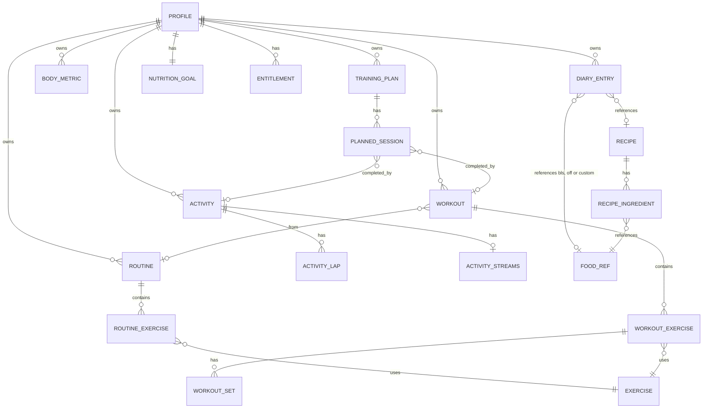

# 03 — Domain Model

A first sketch. Column details are settled per feature PR. Conventions:

- `id uuid` (UUIDv7, can be generated on the client). `user_id` references `auth.users`.
- `created_at`, `updated_at`, `deleted_at` (soft delete for synced entities), `version bigint` (sync), `change_seq bigint` (per-user change feed).
- Every user-owned table has RLS `user_id = auth.uid()`.
- SI units in storage: metres, seconds, kilograms, grams, kcal, bpm.

## Account

| Entity | Key fields |
| --- | --- |
| `profiles` | `user_id` (PK), display_name, avatar_path, birth_date, sex, height_cm, locale (`de`/`en`), time_zone, role (`user`/`admin`), onboarding_completed_at |
| `user_settings` | theme, week_start, notification prefs, health_sync settings |
| `ai_consents` | user_id, consent_version, granted_at, revoked_at |
| `entitlements` | user_id, tier (`free`/`premium`), source (`manual`/`app_store`/`web`), valid_until |
| `ai_usage` | user_id, feature, model, input/output tokens, cost_estimate, created_at |
| `data_exports` | user_id, status, storage_path, expires_at |

## Endurance

| Entity | Key fields |
| --- | --- |
| `activities` | sport (`run`/`ride`/`hike`/`swim_pool`/`swim_open_water`), sub_type (indoor/trail/…), started_at, time_zone, duration_s, moving_time_s, distance_m, elevation_gain_m, avg/max HR, avg pace/speed, avg cadence, energy_kcal, rpe, title, description, private_notes, source (`healthkit`/`fit`/`gpx`/`tcx`/`manual`), external_id, device, visibility (`private`/`link`) |
| `activity_load` | activity_id, load_value, method (`hrtss`/`rtss`/`stss`/`srpe_if`), all on the TSS-equivalent scale, thresholds_version, is_estimate |
| `user_thresholds` | hr_max, hr_rest, lthr, threshold_pace, css (swim), source (`auto`/`user`/`healthkit`), valid_from |
| `daily_training_load` | user_id, date (local), load, ctl, atl, tsb (derived, recomputed by job) |
| `activity_laps` | index, kind (`auto_km`/`device_lap`/`pool_length`), start offset, duration, distance, avg HR, avg pace |
| `activity_streams` | activity_id, compressed columns (time, lat, lng, altitude, HR, cadence, speed, power), downsampled preview (for charts and maps), `route_polyline` (encoded) |
| `activity_files` | original upload (Storage path), parse status |
| `share_links` | target type/id, token, created_at, revoked_at |

Streams are stored as compressed arrays (e.g. `bytea` with columnar delta encoding, or Storage objects with a pointer) to keep row counts small. This is decided in ADR during Phase 1.

## Strength

| Entity | Key fields |
| --- | --- |
| `exercises` | owner_user_id (null = global), slug, equipment, primary/secondary muscles, mechanic, force, type (`weight_reps`/`bodyweight_reps`/`weighted_bodyweight`/`assisted_bodyweight`/`duration`/`distance_duration`), source + source_id |
| `exercise_translations` | exercise_id, locale, name, aliases[], instructions |
| `routine_folders` | name, sort_order |
| `routines` | folder_id, name, notes, sort_order |
| `routine_exercises` | routine_id, exercise_id, sort_order, superset_group, rest_s, notes, target_sets (JSON: type, reps range, weight, RPE) |
| `workouts` | routine_id?, title, started_at, ended_at, time_zone, notes, source (`ios`/`watch`/`web`), recording_mode (`watch_only`/`mirrored`/`phone_only`/`none`), healthkit_save_owner (`watch`/`iphone`/`none`), healthkit_status (`recording`/`saved`/`lost`), healthkit_workout_uuid, avg/max HR, energy_kcal, rpe |
| `workout_exercises` | workout_id, exercise_id, sort_order, superset_group, notes |
| `workout_sets` | workout_exercise_id, index, kind (`normal`/`warmup`/`drop`/`failure`), weight_kg, reps, duration_s, distance_m, rpe, rir, completed_at |
| `personal_records` | (derived) exercise_id, kind (`max_weight`/`est_1rm`/`max_volume_set`/`max_reps`), value, workout_set_id, achieved_at |

## Nutrition

| Entity | Key fields |
| --- | --- |
| **BLS dataset** (CC BY 4.0): `bls_foods`, `bls_nutrients`, `bls_translations`, `bls_servings` | BLS code (PK), category, nutrients per 100 g, de/en names. Read-only, replaced by the importer |
| **OFF dataset** (ODbL): `off_products`, `off_nutrients`, `off_translations`, `off_servings` | barcode (PK), brand, nutrients per 100 g/ml, basis, quantity, completeness/quality score, last_synced_at. Only OFF-derived data, so the **ODbL offer export is scoped to these tables** |
| **Custom foods** (private): `custom_foods`, `custom_food_servings` | owner_user_id, name, brand, nutrients per 100 g/ml, origin (`manual`/`ai_estimate`). RLS. Never part of the OFF/BLS datasets or the OFF export |
| Food reference (type) | **Source-qualified reference** `(food_source, food_ref)` with `food_source ∈ {bls, off, custom}`, used by diary entries, recipe ingredients and favourites instead of a shared `food_id` |
| Search | `search_foods(query, locale, user)` composes per-dataset queries (no shared table) |
| `recipes`, `recipe_ingredients` | private recipes, portions. Ingredients reference `(food_source, food_ref)` + amount + nutrient snapshot |
| `diary_entries` | date (local), meal (`breakfast`/`lunch`/`dinner`/`snack`), `(food_source, food_ref)` or recipe_id or quick-add, amount_g, serving ref, multiplier, **nutrient snapshot**, source (`manual`/`barcode`/`ai_photo`/`ai_text`), ai_recognition_id, healthkit_sample_ids |
| `water_entries` | date, amount_ml |
| `favourite_foods` | user_id, `(food_source, food_ref)` |
| `nutrition_goals` | goal type (`lose`/`maintain`/`gain`), pace kg/week, activity level, macro split, dynamic mode (`off`/`partial`/`full`) + training-energy factor |
| `daily_targets` | (derived per day) base kcal, training kcal added, macro targets |
| `ai_recognitions` | input (photo path, text), model output (items, questions), answers, final items, status |

Diary entries store a **nutrient snapshot**, so later changes to food data don't rewrite history.

## Body

| Entity | Key fields |
| --- | --- |
| `body_metrics` | kind (`weight`/`body_fat`/`waist`/`vo2max`/`resting_hr`/…), value, measured_at, source (`manual`/`healthkit`), external_id |

## Plans & coach

| Entity | Key fields |
| --- | --- |
| `training_plans` | goal (text + structured: type, target event/date, target metric), status, start/end date, generated_by (model, prompt version) |
| `planned_sessions` | plan_id, date, kind (`endurance`/`strength`/`rest`), sport, structure (JSON: warm-up, intervals with targets, cool-down) or routine_id, status (`planned`/`done`/`skipped`/`moved`), completed_activity_id / completed_workout_id, workoutkit_scheduled_id |
| `coach_conversations`, `coach_messages` | user-deletable chat history, tool calls logged |

## Sync

| Entity | Key fields |
| --- | --- |
| `sync_state` | user_id (PK), last_seq. Locked and incremented per write transaction, so `change_seq` follows commit order |
| `sync_mutations` | (user_id, mutation_id) unique, entity, entity_id, base_version, applied_at, result (applied/conflict + server record) |
| `change_seq` column | on every synced table, plus tombstones (soft-deleted rows, retained for 90 days) |
| `devices` | user_id, kind (`iphone`/`watch`/`web`), name, auth session ID, last_seen_at, revoked_at |
