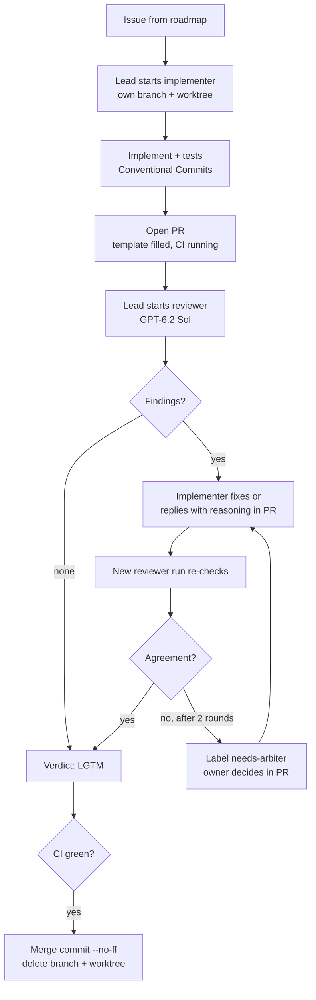

# 05 — Development Workflow

## Roles

| Role | Who | Responsibilities |
| --- | --- | --- |
| **Owner / arbiter** | Sören | Approves the plan and scope changes, arbitrates review disagreements, holds secrets and accounts (Apple, Supabase, Dokploy) |
| **Lead agent** | Claude (orchestrating session) | Turns roadmap tasks into issues, starts implementer subagents, handles review rounds, merges |
| **Implementer** | Claude subagent, one per task | Implements one task in its own worktree, writes tests, opens the PR, answers review comments |
| **Reviewer** | **GPT-6.2 Sol** (Codex delegate) | Reviews every PR and comments on it, re-checks after fixes, gives a final verdict |
| **Designer** | **GPT-6.2 Astra** (Codex delegate) | Brand identity, icon, visual design proposals |

## Task lifecycle

## Branches & worktrees

- `main` is always deployable. No direct pushes (ruleset). Only merge commits.
- Branch name: `<type>/<issue-id>-<slug>`, e.g. `feat/1.3-healthkit-workout-import`, `docs/0.1-project-plan`.
- Each task gets its own **git worktree**. Agents started by the lead use isolated worktrees managed by the orchestrator. Manual worktrees go to `.worktrees/<branch-name>` (git-ignored).
- Branches stay short-lived (ideally < 2 days). If `main` moves on, the branch is **rebased before review** (it's our own branch, so force-pushing with `--force-with-lease` is fine before the final review round), or `main` is merged in once review has started, so review comments keep their context.

## Commits

- [Conventional Commits 1.0](https://www.conventionalcommits.org/): `type(scope): subject`
  - types: `feat`, `fix`, `docs`, `style`, `refactor`, `perf`, `test`, `build`, `ci`, `chore`, `revert`
  - scopes: `api`, `web`, `landing`, `apple`, `watch`, `db`, `domain`, `contracts`, `ai`, `i18n`, `ui`, `deploy`, `deps`
  - breaking changes: `feat(api)!: …` + a `BREAKING CHANGE:` footer
- Several small, logical commits per PR. Each commit should build. Since we don't squash, **commit history is part of the review**: no "wip" / "fix typo" noise. Fix-ups are folded in with `git commit --fixup` + `git rebase --autosquash` before the final review round.
- Enforced by commitlint (local hook via lefthook + CI on all PR commits and the PR title).
- Commits are signed (SSH, 1Password agent).
- Agent commits carry a `Co-Authored-By:` trailer naming the model.

## Pull requests

- One PR per roadmap task. Target size ≤ ~400 changed lines, excluding generated files, lockfiles and fixtures. Larger tasks are split (e.g. `1.3a`, `1.3b`).
- The PR title is a Conventional Commit (`feat(apple): import Apple Workouts via HealthKit`).
- The template contains: linked issue, summary, scope (in/out), how it was tested, screenshots (UI), migration notes, checklist (tests, i18n de/en, docs/ADR, no secrets).
- Draft PR while CI is red. Marked ready when CI is green and self-review is done.

## Review protocol (GPT-6.2 Sol)

1. When a PR is ready, the lead starts a **new Codex delegate** (`gpt-6.2-sol`, reasoning effort `high`; `xhigh` for security-relevant or architectural PRs) with the PR number, the linked issue and the relevant plan sections.
2. The reviewer reads the diff and posts a **GitHub review** with inline comments plus a summary comment.
   - Each comment starts with **`[Sol]`** and a severity: `blocker`, `major`, `minor`, `nit`, `question`.
   - The summary ends with a verdict: `Verdict: changes requested` or `Verdict: LGTM`.
3. The implementer answers **every** comment in its thread, prefixed with **`[Claude]`**: either "Fixed in `<sha>`" or a reasoned disagreement.
4. For re-checks, the lead starts a **new** reviewer run that receives the previous findings and the replies. It resolves fixed threads and responds to disagreements.
5. **Disagreement:** after at most two exchanges on a thread, the lead adds the label `needs-arbiter` and posts a short summary of both positions. **The owner decides** in the PR. Their decision is final and documented in the thread.
6. Merge requires: `Verdict: LGTM` (nits may remain open if marked as follow-ups), all `blocker`/`major` threads resolved, CI green, no `needs-arbiter` label.

> **Note:** all agents use the owner's GitHub account (`gh` auth), so GitHub shows every comment as written by the owner. The `[Sol]`/`[Claude]` prefixes make authorship visible. GitHub also doesn't let you formally "approve" your own PR, so the reviewer posts `COMMENT` reviews and the verdict line is the approval signal. A dedicated bot account or GitHub App would fix both; it's an optional later improvement.

## Merging

- `gh pr merge --merge --delete-branch` (merge commit). **Squash and rebase merges are disabled** in the repo settings.
- The lead merges once all merge criteria are met. The owner can always merge or veto manually.
- After merging: remove the worktree, close the issue (via `Closes #n` in the PR), and the staging deploy runs automatically.

## Parallelism

- The lead runs implementers in parallel only for tasks marked ∥ in the roadmap, when their dependencies are merged and they touch disjoint areas (e.g. `apps/web` vs. `apps/apple`).
- Default maximum: **3 concurrent implementers**, plus their reviewers.
- Shared files (`packages/contracts`, migrations, `openapi.json`) are a serialisation point. Only one in-flight PR may add migrations at a time. The PR that merges second rebases and regenerates.

## Definition of done

- [ ] Acceptance criteria from the issue are met
- [ ] Tests: unit for domain logic, integration for API endpoints, UI tests for critical flows
- [ ] Strings in de + en
- [ ] OpenAPI/client regenerated if the API changed
- [ ] Docs/ADR updated if architecture or behaviour changed
- [ ] CI green, review LGTM, no open blockers

## Releases

- release-please keeps a release PR open on `main` and maintains `CHANGELOG.md` and versions.
- Merging the release PR → tag `vX.Y.Z` → production deploy (manual approval in GitHub Environments).
- The iOS build number comes from CI. The marketing version follows the release version.
