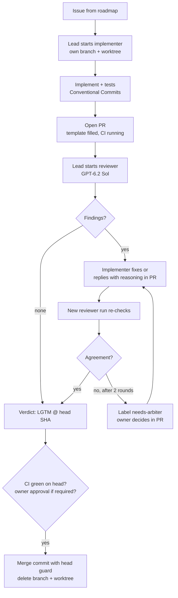

# 05 — Development Workflow

## Roles

| Role | Who | Responsibilities |
| --- | --- | --- |
| **Owner / arbiter** | Sören | Approves the plan and scope changes, arbitrates review disagreements, holds secrets and accounts (Apple, Supabase, Dokploy) |
| **Lead agent** | Claude (orchestrating session) | Turns roadmap tasks into issues, starts implementer subagents, handles review rounds, merges |
| **Implementer** | Claude subagent, one per task | Implements one task in its own worktree, writes tests, opens the PR, answers review comments |
| **Reviewer** | **GPT-6.2 Sol** (Codex delegate) | Reviews every PR and comments on it, re-checks after fixes, gives a final verdict |
| **Designer** | **GPT-6.2 Astra** (Codex delegate) | Brand identity, icon, visual design proposals |

## Task lifecycle

## Branches & worktrees

- `main` is always deployable. No direct pushes (ruleset). Only merge commits.
- Branch name: `<type>/<issue-id>-<slug>`, e.g. `feat/1.3-healthkit-workout-import`, `docs/0.1-project-plan`.
- Each task gets its own **git worktree**. Agents started by the lead use isolated worktrees managed by the orchestrator. Manual worktrees go to `.worktrees/<branch-name>` (git-ignored).
- Branches stay short-lived (ideally < 2 days). If `main` moves on, the branch is **rebased before review** (it's our own branch, so force-pushing with `--force-with-lease` is fine before the final review round), or `main` is merged in once review has started, so review comments keep their context.

## Commits

- [Conventional Commits 1.0](https://www.conventionalcommits.org/): `type(scope): subject`
  - types: `feat`, `fix`, `docs`, `style`, `refactor`, `perf`, `test`, `build`, `ci`, `chore`, `revert`
  - scopes: `api`, `web`, `landing`, `apple`, `watch`, `db`, `domain`, `contracts`, `ai`, `i18n`, `ui`, `deploy`, `deps`, `plan` (plan docs under `docs/plan/`)
  - breaking changes: `feat(api)!: …` + a `BREAKING CHANGE:` footer
- Several small, logical commits per PR. Each commit should build. Since we don't squash, **commit history is part of the review**: no "wip" / "fix typo" noise. Fix-ups are folded in with `git commit --fixup` + `git rebase --autosquash` before the final review round.
- Enforced by commitlint (local hook via lefthook + CI on all PR commits and the PR title).
- Commits are signed with the dedicated SSH signing key (`~/.ssh/enduva_signing_ed25519`, no 1Password, configured repo-locally, registered on GitHub as a signing key; see W9). Agents never disable signing. If signing fails, they stop and report.
- Agent commits carry a `Co-Authored-By:` trailer naming the model.

## Pull requests

- One PR per roadmap task. Target size ≤ ~400 changed lines, excluding generated files, lockfiles and fixtures. Larger tasks are split (e.g. `1.3a`, `1.3b`).
- The PR title is a Conventional Commit (`feat(apple): import Apple Workouts via HealthKit`).
- The template contains: linked issue, summary, scope (in/out), how it was tested, screenshots (UI), migration notes, checklist (tests, i18n de/en, docs/ADR, no secrets).
- Draft PR while CI is red. Marked ready when CI is green and self-review is done.

## Review protocol (GPT-6.2 Sol)

1. When a PR is ready, the lead starts a **new Codex delegate** (`gpt-6.2-sol`, reasoning effort `high`; `xhigh` for security-relevant or architectural PRs) with the PR number, the linked issue and the relevant plan sections.
2. The reviewer reads the diff and posts a **GitHub review** with inline comments plus a summary comment.
   - Each comment starts with **`[Sol]`** and a severity: `blocker`, `major`, `minor`, `nit`, `question`.
   - The summary ends with a verdict bound to the reviewed head: `Verdict: changes requested @ <full-sha>` or `Verdict: LGTM @ <full-sha>`.
3. The implementer answers **every** comment in its thread, prefixed with **`[Claude]`**: either "Fixed in `<sha>`" or a reasoned disagreement.
4. For re-checks, the lead starts a **new** reviewer run that receives the previous findings and the replies. It resolves fixed threads and responds to disagreements.
5. **Disagreement:** after at most two exchanges on a thread, the lead adds the label `needs-arbiter` and posts a PR comment `[Claude] arbiter request` summarising both positions. **The owner decides** by replying in that thread (or the PR) with `Ruling: …`. Then the lead (a) implements the ruling if needed, (b) replies `[Claude] ruling applied in <sha>`, (c) resolves the thread and (d) removes the label. The ruling is final. The next reviewer run receives it and must not re-raise the point.
6. **The verdict is bound to a commit.** The reviewer's summary names the reviewed head: `Verdict: LGTM @ <full-sha>`. Any push after that invalidates the verdict, and a new reviewer run (at least a delta review) is required.
7. **Merge requires**, all for the **current head SHA**:
   - `Verdict: LGTM @ <head-sha>`. Nits may remain open if they are turned into follow-up issues.
   - All `blocker`/`major` threads resolved.
   - All required status checks green **on that head** (checks re-run after every push).
   - No `needs-arbiter` label.
   - **Owner approval** (`Approved @ <sha>` comment) for PRs that change `docs/plan/`, ADRs, licence, security-relevant config, or that the owner asked to review.
8. **Merge with a head guard:** `gh pr merge <n> --merge --match-head-commit <head-sha>`, so a push between verification and merge aborts the merge.

> **Note:** all agents use the owner's GitHub account (`gh` auth), so GitHub shows every comment as written by the owner. The `[Sol]`/`[Claude]`/`[Astra]` prefixes make authorship visible. GitHub also doesn't let you approve your own PR, so the "required approvals" rule can't enforce the review. **Enforcement is therefore split:**
> - **GitHub ruleset on `main`** (task 0.5): pull request required, required status checks (lint, typecheck, test, build, commitlint, gitleaks, CLA) that must pass on the latest commit, no force pushes, no deletions, only merge commits allowed.
> - **Review verdict + owner approval:** enforced by the merge procedure above (head-bound verdict + `--match-head-commit`). Optionally later, a small required status check (GitHub Action) can parse the latest `[Sol] … Verdict: LGTM @ <sha>` and fail if the SHA doesn't equal the head.
> - A dedicated bot account or GitHub App for the reviewer would enable real approvals. That's an optional later improvement.

## Merging

- `gh pr merge <n> --merge --match-head-commit <sha> --delete-branch` (merge commit). **Squash and rebase merges are disabled** in the repo settings.
- The lead merges once all merge criteria are met. The owner can always merge or veto manually.
- After merging: remove the worktree, close the issue (via `Closes #n` in the PR), and the staging deploy runs automatically.

## Parallelism

- The lead runs implementers in parallel only for tasks marked ∥ in the roadmap, when their dependencies are merged and they touch disjoint areas (e.g. `apps/web` vs. `apps/apple`).
- Default maximum: **3 concurrent implementers**, plus their reviewers.
- Shared files (`packages/contracts`, migrations, `openapi.json`) are a serialisation point. Only one in-flight PR may add migrations at a time. The PR that merges second rebases and regenerates.

## Definition of done

- [ ] Acceptance criteria from the issue are met
- [ ] Tests: unit for domain logic, integration for API endpoints, UI tests for critical flows
- [ ] Strings in de + en
- [ ] OpenAPI/client regenerated if the API changed
- [ ] Docs/ADR updated if architecture or behaviour changed
- [ ] CI green, review LGTM, no open blockers

## Releases

- release-please keeps a release PR open on `main` and maintains `CHANGELOG.md` and versions.
- Merging the release PR → tag `vX.Y.Z` → production deploy (manual approval in GitHub Environments).
- The iOS build number comes from CI. The marketing version follows the release version.
