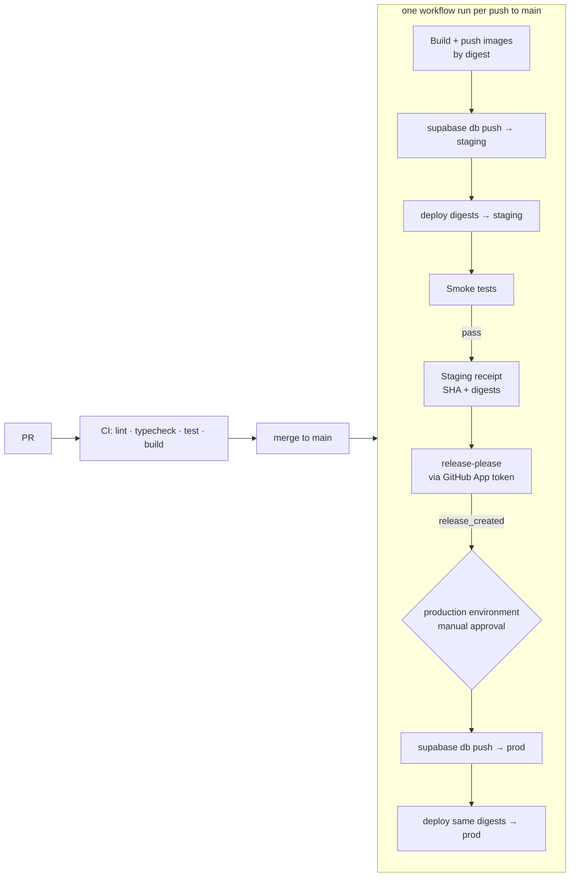

# 06 — Deployment & Operations

## Environments

| Env | Landing | Web app | API | Database | Trigger |
| --- | --- | --- | --- | --- | --- |
| **local** | `localhost:5174` | `localhost:5173` | `localhost:3000` | Supabase CLI (`supabase start`, Docker) | `pnpm dev` |
| **staging** | `staging.enduva.soeenplop.dev` | `app-staging.enduva.soeenplop.dev` | `api-staging.enduva.soeenplop.dev` | Supabase Cloud project `enduva-staging` (EU) | Merge to `main` |
| **production** | `enduva.soeenplop.dev` | `app.enduva.soeenplop.dev` | `api.enduva.soeenplop.dev` | Supabase Cloud project `enduva-prod` (EU, Frankfurt) | Release tag + manual approval |

Staging domains are a proposal (O8). Wildcard DNS already points to the Dokploy server. Traefik in Dokploy issues Let's Encrypt certificates per host.

## Docker Compose

`deploy/compose.yaml` defines one stack per environment in Dokploy:

| Service | Image | Command | Notes |
| --- | --- | --- | --- |
| `api` | `ghcr.io/soeenplop/enduva-api:<tag>` | `node dist/main.js` | Port 3000, health check `/v1/health` |
| `worker` | same image as `api` | `node dist/worker.js` | pg-boss consumers. Scale independently |
| `web` | `ghcr.io/soeenplop/enduva-web:<tag>` | `node build` | SvelteKit `adapter-node` |
| `landing` | `ghcr.io/soeenplop/enduva-landing:<tag>` | static server (Caddy/nginx) | Prerendered |

- There is no database in the compose file: Supabase Cloud is used for staging and production.
- Images: multi-stage builds, `pnpm deploy --prod` for minimal node_modules, non-root user, distroless or alpine runtime.
- Labels/domains are configured in Dokploy (via CLI). Env vars come from Dokploy's environment settings.

## Pipeline

- **Strict ordering in one run:** every push to `main` runs build → staging migrations → staging deploy → smoke tests → **staging receipt** → release-please → (only if a release was created) production. A release can therefore never be created before its commit passed staging. The receipt (release SHA + image digests + smoke result) is stored durably as a GitHub deployment status + artifact.
- **Production requires a receipt:** the production job (protected `production` environment, manual approval) looks up the receipt for the **exact release SHA**. It refuses to run migrations or deploy if the receipt is missing or failed.
- **Recovery:** if anything fails after the release was created (e.g. a flaky smoke test), the fix is to **re-run the failed jobs** of that run, or to start a `workflow_dispatch` "promote release" workflow with the tag. It re-uses an existing receipt, or redeploys that SHA to staging and smoke-tests it first. No manual tagging.
- **Release PR checks:** release-please authenticates with a **GitHub App token** ("Enduva Release" app, installed only on this repo with contents + pull-requests write), not `GITHUB_TOKEN`. Its release PRs therefore trigger the required checks normally, and the PR can be merged under the ruleset like any other PR.
- **Promote, don't rebuild:** every image is referenced **by digest** (`…@sha256:…`). Production deploys exactly the digests from the receipt. 0.12c/0.12d prove that the Dokploy CLI deploys a pinned digest (compose file rendered with digests, then `dokploy compose` deploy).
- **0.12d acceptance:** run the whole chain from a generated release PR (required checks start automatically) through merge to the production deploy, including once with **deliberately slow staging** (production waits) and once with a **failing smoke test** (no release, no prod deploy, recovery via re-run).
- **Serialisation:** GitHub Actions `concurrency` groups per environment (`deploy-staging`, `deploy-production`) so migrations and deploys never overlap. Migrations always run before the deploy in the same job.

- Deploy commands go through the **Dokploy CLI** (`dokploy compose …`, installed v0.30.x), scripted in `deploy/scripts/deploy.sh` so they run the same way locally and in GitHub Actions. The exact commands are fixed in task 0.12 (`dokploy compose --help`).
- Migrations are **expand/contract** (backwards-compatible), so a deploy never breaks the previous API version during rollout.
- Apple builds: built and signed locally (Xcode 27) or via Xcode Cloud / GitHub macOS runners (decided in 0.11; public repos get free macOS runners). Uploaded to App Store Connect via a **supported upload path** (Xcode Organizer, Transporter, or `xcrun altool --upload-app` where still supported, or fastlane `pilot`, which wraps these). Task 0.11b pins one path and checks that the build finishes processing and shows up in TestFlight internal. (`notarytool` is for macOS notarisation and is not used.)

## Supabase

- **Local:** `supabase start`. Migrations in `supabase/migrations`, seed in `supabase/seed.sql` + TS seed scripts for BLS/exercise data. `supabase db reset` gives a clean state.
- **Cloud:** two projects (staging, prod) in an EU region. Auth configuration (redirect URLs, Google OAuth client, email templates de/en, SMTP via a transactional mail provider) lives in `supabase/config.toml` where possible and is otherwise documented.
- **Connections:** the API uses the **transaction pooler** (transaction-local identity, no named prepared statements). The worker uses pg-boss in its default **polling** mode (no `LISTEN/NOTIFY`) over the **session pooler**, so it is independent of IPv6 support for direct connections. Task 0.12b tests enqueue and consume against the real staging connection strings.
- **Connection budget:** API pool ≈ 10 per replica, worker ≈ 5 per replica (pg-boss maintenance included). The total stays below the plan's pooler/client limits with headroom for migrations and admin. Documented in `deploy/README.md` and revisited when scaling replicas.
- **Storage buckets:** `avatars` (public-read via signed URLs), `activity-files`, `meal-photos` (private, retention policy), `exports` (private, 7-day expiry).
- **Plan:** free tier for staging. Production on Pro once real users exist (backups/PITR, no pausing, 8 GB DB). See O4.

## Secrets & configuration

| Where | What |
| --- | --- |
| 1Password Environments | Local `.env` files (Supabase local keys, OpenAI key, MapTiler key, Google OAuth) mounted per developer |
| GitHub Actions secrets (per environment) | `DOKPLOY_URL`, `DOKPLOY_TOKEN`, `SUPABASE_ACCESS_TOKEN`, `SUPABASE_DB_PASSWORD`, project refs, `GHCR` (via `GITHUB_TOKEN`), Apple signing (later) |
| Dokploy environment | Runtime env for `api`, `worker` and `web` (DB URLs, Supabase URL + publishable key, OpenAI key, Sentry DSN, …) |

- `.env.example` per app documents every variable. The API validates env at boot with Zod and refuses to start if something is missing.
- Gitleaks in CI. The repo is public, so **never** commit real values.

## Observability & operations

- **Logs:** pino JSON → Dokploy log viewer. Request IDs propagated to clients in the `x-request-id` header.
- **Errors:** Sentry (or GlitchTip, O7) for API, worker, web and iOS.
- **Uptime:** health checks in Dokploy plus an external uptime monitor (e.g. Uptime Kuma on Dokploy) for landing, app and API.
- **Backups:**
  - *Database:* Supabase Pro daily backups (prod). PITR is a **paid add-on on top of Pro** and only added if the data volume justifies it (budget: decided with O4). Plus a nightly encrypted `pg_dump` to S3-compatible storage (GitHub Actions cron) for the owner's own retention (30 days).
  - *Storage objects:* database backups only contain Storage **metadata**, not the files. Buckets with irreplaceable data (`activity-files` originals, `avatars`) are synced nightly to encrypted object storage (e.g. `rclone` with server-side encryption), with 30-day retention. `meal-photos` (deleted after recognition per retention policy) and `exports` (temporary) are **not** backed up.
  - *Deletions vs. restores:* account deletions are recorded in a deletion log. After any restore, the log is replayed so deleted users stay deleted (GDPR).
  - *Restore drill:* restore DB + objects into a scratch project in maintenance mode, replay the deletion log, verify, then serve (task G1.4 before real data, again on production backups in 5.2, then at least twice a year).
  - *Deletion log* lives **outside the rollback boundary** (versioned object storage or a separate database, task G1.3), so a database restore can't roll it back.
- **Runbooks** in `docs/runbooks/`: deploy rollback (redeploy previous tag), restore from backup, rotate keys, AI quota emergency stop (feature flag).
