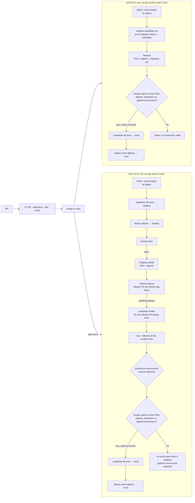

# 06 — Deployment & Operations

## Environments

| Env | Landing | Web app | API | Database | Trigger |
| --- | --- | --- | --- | --- | --- |
| **local** | `localhost:5174` | `localhost:5173` | `localhost:3000` | Supabase CLI (`supabase start`, Docker) | `pnpm dev` |
| **staging** *(from G1.6)* | `staging.enduva.de` | `app.staging.enduva.de` | `api.staging.enduva.de` | Supabase Cloud project `enduva-staging` (EU), created in G1.6 | Merge to `main` |
| **production** | `enduva.de` | `app.enduva.de` | `api.enduva.de` | Supabase Cloud production project (EU; exists, credentials in the 1Password Environment `enduva`) | **Until G1.6:** merge to `main` after isolated verification. **From G1.6:** release tag + manual approval |

**Single-environment phase (T25):** until task G1.6 there is no staging environment. Production holds synthetic data only. In the pipeline below, the **isolated candidate environment** takes the place of staging: every push to `main` is verified there (migrations from the production history + candidate migrations, candidate image digests, smoke tests), produces the receipt, and is then deployed to production. From G1.6 on, the full staging → release → production flow below applies.

All of these names (and `errors.enduva.de` for GlitchTip, `tiles.enduva.de` for the tile proxy) point to the Dokploy server via DNS records for `enduva.de`; `www.enduva.de` redirects to `enduva.de`. The product domain moved from `enduva.soeenplop.dev` on 2026-11-28; the Dokploy dashboard itself stays under `soeenplop.dev`. Traefik in Dokploy issues Let's Encrypt certificates per host.

## Docker Compose

`deploy/compose.production.yaml` is the production stack in Dokploy (0.12c): images by digest, filled in by the deploy script, and env from Dokploy. `deploy/compose.yaml` builds the images and starts them locally against the local Supabase stack (0.12a, [`deploy/README.md`](../../deploy/README.md)).

| Service | Image | Command | Notes |
| --- | --- | --- | --- |
| `api` | `ghcr.io/soeenplop/enduva-api:<tag>` | `node dist/main.js` | Port 3000, health check `/v1/health` |
| `worker` | same image as `api` | `node dist/worker.js` | pg-boss consumers. Scale independently |
| `web` | `ghcr.io/soeenplop/enduva-web:<tag>` | `node server.mjs` (srvx on Node, SSR bundle with its dependencies, pinned in 0.12a) | TanStack Start SSR. Health check `/healthz` |
| `landing` | `ghcr.io/soeenplop/enduva-landing:<tag>` | static server (unprivileged nginx, 0.12a) | Prerendered |
| `tiles` | Caddy/nginx (pinned digest) | caching reverse proxy | `tiles.enduva.de` → OpenFreeMap. Strips cookies, `Referer`, user agents. Disk cache |

- There is no database in the compose file: Supabase Cloud is used for production (and staging from G1.6).
- Images: multi-stage builds, `pnpm deploy --prod` for minimal node_modules, non-root user, distroless or alpine runtime.
- Labels/domains are configured in Dokploy (via CLI). Env vars come from Dokploy's environment settings.

## Pipeline

- **Serialised pipeline:** the `main` pipeline runs in one `concurrency` group (`main-pipeline`, `cancel-in-progress: false`), so runs never overlap: a later push waits until the earlier run has finished.
- **Migrations are bound to the SHA:** a receipt records the migration head it was tested with. Staging and production only ever apply the migrations **from the checkout of the SHA being deployed**.
- **Candidate verification when staging has moved on:** if a pending release has no receipt and shared staging already runs a newer commit (e.g. a newer push with a new migration was processed first), the candidate is **not** tested on shared staging. Instead the job starts an **isolated candidate environment** in CI: a fresh Supabase local stack, the production migration history replayed, then the candidate's migrations, plus the candidate's image digests via `compose`, followed by the same smoke tests. That produces the receipt.
- **Release candidate = tested SHA:** release-please only runs `release-pr` (open/update the release PR) on every push. The release step is **driven by the pending release, not by the run's own SHA**: it looks up the merged release PR still labelled `autorelease: pending` and takes **its merge commit SHA**, which is exactly the SHA release-please will tag. It calls the **candidate verifier** (see below) for that SHA. Then the workflow **creates the tag and GitHub release itself on exactly that SHA** (`gh release create vX.Y.Z --target <verified-sha>` with the changelog section from the release PR) and relabels the PR `autorelease: tagged`. release-please is configured with `skip-github-release: true`, so it only maintains the release PR and changelog and **never chooses a tagging candidate**. The verified SHA and the published SHA are therefore the same by construction.
- **No lost releases:** because the release step works from the `autorelease: pending` label, it doesn't matter which run handles it. If GitHub cancels a queued run (only one pending run per concurrency group is kept), the next push, an hourly scheduled run or a manual `workflow_dispatch` picks up the pending release. Retries use the same lookup, so a retry can never publish a different candidate.
- **Strict ordering in one run:** every push to `main` runs build → staging migrations → staging deploy → smoke tests → **staging receipt** → release-please → (only if a release was created) production. A release can therefore never be created before its commit passed staging. The receipt (release SHA + image digests + smoke result) is stored durably as a GitHub deployment status + artifact.
- **Production requires a receipt (both paths):** before **any** production write, the job looks up the receipt for the **exact SHA** (the push SHA in the continuous phase, the release SHA from G1.6) and checks that its image digests and migration set match. Under the production concurrency lock, it then reads the **applied production migration history** and verifies that the receipt was produced against exactly that history. Migrations and deploy run in the same locked job, so no other deploy can change the history in between. A missing, failed or mismatched receipt makes it **refuse** to migrate or deploy. In the continuous phase this is an unattended job; from G1.6 it additionally requires manual approval in the protected `production` environment.
- **Candidate verifier (single code path for release, retries and recovery):** there are two kinds of receipt. A **staging receipt** proves the candidate ran on staging. A **production receipt** proves it was verified against the **current production baseline** (the applied production migration history). **Only a production receipt can authorise a production write.** For a production promotion the verifier (1) reuses an existing production receipt for the SHA only if its recorded baseline equals the current production history. Otherwise (2) it verifies the same SHA in the **isolated candidate environment** against the current production baseline (production history replayed, then the candidate's migrations and image digests, same smoke tests), which produces a new production receipt. A staging smoke test on its own never produces a production receipt. For a staging deploy, staging may be used directly only if it runs **exactly** that SHA (image digests **and** applied migration history identical to the candidate's), because a failed deploy can leave old images on a newer schema. Otherwise the isolated environment is used as well. The candidate is **never** deployed back onto shared staging.
- **Recovery:** if anything fails after the release was created (e.g. a flaky smoke test), the fix is to **re-run the failed jobs** of that run, or to start a `workflow_dispatch` "promote release" workflow with the tag. Both go through the candidate verifier. No manual tagging.
- **Release PR checks:** release-please authenticates with a **GitHub App token** ("Enduva Release" app, installed only on this repo with contents + pull-requests write), not `GITHUB_TOKEN`. Its release PRs therefore trigger the required checks normally, and the PR can be merged under the ruleset like any other PR.
- **Promote, don't rebuild:** every image is referenced **by digest** (`…@sha256:…`). Production deploys exactly the digests from the receipt. 0.12c/0.12d prove that the Dokploy CLI deploys a pinned digest (compose file rendered with digests, then `dokploy compose` deploy).
- **Receipt edge cases (0.12c/0.12d acceptance):** a staging receipt (or a staging smoke test alone) is never accepted for production, and a retry after migrations succeeded but the image deploy failed re-verifies against the advanced production baseline instead of reusing the old receipt.
- **0.12d acceptance:** run the whole release chain from a generated release PR (required checks start automatically) through merge, verification, tagging and deploy **against the isolated rehearsal target**, including a **failing smoke test** (no release, no deploy, recovery via re-run). The live staging → approved-production exercise with **deliberately slow staging** happens in G1.6.
- **Serialisation:** GitHub Actions `concurrency` groups per environment (`deploy-staging`, `deploy-production`) so migrations and deploys never overlap. Migrations always run before the deploy in the same job.

- Deploys go through `deploy/scripts/deploy.sh` (0.12c): it stores the rendered compose file (`compose.update`, source `raw`), starts `compose.deploy` and waits for the deployment's status. It uses the same Dokploy API that the Dokploy CLI v0.30.x wraps, but calls it with curl: the CLI's dependencies aren't pinned, and it reads a `.env` file from the working directory.
- Migrations are **expand/contract** (backwards-compatible), so a deploy never breaks the previous API version during rollout.
- Apple builds: built and signed locally (Xcode 27) or via Xcode Cloud / GitHub macOS runners (decided in 0.11; public repos get free macOS runners). Uploaded to App Store Connect via a **supported upload path** (Xcode Organizer, Transporter, or `xcrun altool --upload-app` where still supported, or fastlane `pilot`, which wraps these). Task 0.11b pins one path and checks that the build finishes processing and shows up in TestFlight internal. (`notarytool` is for macOS notarisation and is not used.)

## Supabase

- **Local:** `supabase start`. Migrations in `supabase/migrations`, seed in `supabase/seed.sql` + TS seed scripts for BLS/exercise data. `supabase db reset` gives a clean state.
- **Cloud:** the production project in an EU region now, and a staging project from G1.6. Auth configuration (redirect URLs, Google OAuth client, email templates de/en, SMTP via a transactional mail provider) lives in `supabase/config.toml` where possible and is otherwise documented.
- **Sign in with Apple (web):** one Apple Services ID with the Supabase callback URL per environment. Apple's client secret is a JWT that expires after at most six months, so a **scheduled GitHub Action** regenerates it monthly from the Apple key (`.p8`, stored as an Actions secret) and updates the Supabase Auth config of **every existing project** (production now, staging from G1.6) via the Management API. Rotation smoke test: a token request to Apple with the new secret and a dummy code must fail with `invalid_grant` (secret accepted), not `invalid_client`. A failed rotation alerts the owner. The lead agent maintains the workflow, and the owner owns the Apple key.
- **Connections:** the API uses the **transaction pooler** (transaction-local identity, no named prepared statements). The worker uses pg-boss in its default **polling** mode (no `LISTEN/NOTIFY`) over the **session pooler**, so it is independent of IPv6 support for direct connections. Task 0.12c tests enqueue and consume against the real production connection strings (synthetic data) **after the first receipt-gated migration** has created the queue schema, and G1.6 repeats it for staging when it is provisioned.
- **Connection budget:** API pool ≈ 10 per replica, worker ≈ 5 per replica (pg-boss maintenance included). The total stays below the plan's pooler/client limits with headroom for migrations and admin. Documented in `deploy/README.md` and revisited when scaling replicas.
- **Storage buckets:** `avatars`, `activity-files`, `meal-photos` (retention policy), `exports` (7-day expiry), **all private**: no Storage policies for `anon`/`authenticated`, and no public or signed download URLs. Objects are served only through the API (see architecture). Checked by a test that tries direct reads with a user JWT.
- **Plan:** Free for production until G1, and Free for staging once it exists (no real data before then). Production moves to **Pro** when G1 passes (daily backups, no pausing, 8 GB DB). PITR is optional. See T13a.

## Secrets & configuration

| Where | What |
| --- | --- |
| 1Password Environments | Local `.env` files (Supabase local keys, OpenAI key, map style URL (OpenFreeMap by default, no key), Google + Apple OAuth) mounted per developer |
| GitHub Actions secrets (per environment) | `DOKPLOY_URL`, `DOKPLOY_TOKEN`, `SUPABASE_ACCESS_TOKEN`, `SUPABASE_DB_PASSWORD`, project refs, `GHCR` (via `GITHUB_TOKEN`), Apple signing (later) |
| Dokploy environment | Runtime env for `api`, `worker` and `web` (DB URLs, Supabase URL + publishable key, OpenAI key, GlitchTip DSN, …) |

- `.env.example` per app documents every variable. The API validates env at boot with Zod and refuses to start if something is missing.
- Gitleaks in CI. The repo is public, so **never** commit real values.

## Observability & operations

- **Logs:** pino JSON → Dokploy log viewer. Request IDs propagated to clients in the `x-request-id` header. Logs never contain health payloads or tokens. Client IPs are truncated. **Tile and share paths** are not logged together with client IPs or referrers anywhere (API, tile proxy, Traefik ingress); see 0.12f.
- **Errors:** self-hosted **GlitchTip** (separate Dokploy compose stack with its own Postgres + Valkey, at `errors.enduva.de`, task 0.12e) for API, worker, web, landing and iOS, via the Sentry SDKs. Its database is included in the nightly dumps. Alerts go out by email.
- **Uptime:** health checks in Dokploy plus an external uptime monitor (e.g. Uptime Kuma on Dokploy) for landing, app and API.
- **Backups:**
  - *Database:* Supabase Pro daily backups (prod). PITR is a **paid add-on on top of Pro** and only added if the data volume justifies it (budget decision with T13a). Plus a nightly encrypted `pg_dump` to S3-compatible storage (GitHub Actions cron) for the owner's own retention (30 days).
  - *Storage objects:* database backups only contain Storage **metadata**, not the files. Buckets with irreplaceable data (`activity-files` originals, `avatars`) are synced nightly to encrypted object storage (e.g. `rclone` with server-side encryption), with 30-day retention. `meal-photos` (deleted after recognition per retention policy) and `exports` (temporary) are **not** backed up.
  - *Deletions vs. restores:* account deletions are recorded in a deletion log. After any restore, the log is replayed so deleted users stay deleted (GDPR).
  - *Restore drill:* restore DB + objects into a scratch project in maintenance mode, **replay the entire privacy event log** (idempotent, not just events newer than the backup) **before any API or worker starts**, verify, then serve (task G1.4 before real data, again on production backups in 5.2, then at least twice a year).
  - *Privacy event log* (account deletions, consent changes, completed health-data purges) lives **outside the rollback boundary** (versioned object storage or a separate database, task G1.3), so a database restore can't roll it back.
- **Runbooks** in `docs/runbooks/`: deploy rollback (redeploy previous tag), restore from backup, rotate keys, AI quota emergency stop (feature flag).
